[English](../roadmap.md)

# ondina ロードマップと進捗

マイルストーンの定義（目的と完了条件）は `design.md` 13 章。**進捗はこのファイルだけで管理する**。項目を終えたら図の `:done` とチェックリストの `[x]` を同じ PR で更新し、日付と実装場所を書く。

図は順序だけを表す（日付は表さない）。緑 = 済、青 = 進行中、灰 = 未着手。

```mermaid
gantt
  title ondina M0 → M4（順序。日付ではない）
  dateFormat X
  axisFormat %s
  todayMarker off
  section M0 差分ビューア
    足場・fixture・意味的 hunk         :done, m0a, 0, 1
    gh + git worktree で base/head     :done, m0b, 1, 2
    Shiki 字句ハイライト               :done, m0c, 2, 3
    差分一覧 + ondina serve            :done, m0d, 3, 4
    IDEA で開く                        :done, m0e, 3, 4
    コメントの GitHub 送信             :done, m0f, 4, 5
    ondina.config.yaml の読み込み      :done, m0g, 5, 6
  section M1 How 分解と説明
    追従検出（AST 判定）               :done, m1a, 6, 8
    layers の glob 割当（symbols）      :done, m1d, 8, 9
    LLM ラベリングと Stage 3 検証      :done, m1b, 8, 10
    目的ごと・説明・完了メーター       :done, m1c, 10, 12
    コマンドパレット（⌘K）             :done, m1e, 12, 13
  section M2 コースと LSP
    kotlin-lsp 起動・待機・フォールバック :done, m2a, 12, 14
    意味トークンの重ね合わせ           :done, m2b, 14, 15
    callHierarchy → 辺・型ラベル・層越え :done, m2c, 15, 17
    層の推定・testCount・LLM 入力の layer :done, m2e, 15, 17
    参照辺・経路（tours）              :done, m2f, 17, 18
    elkjs の地図・読む順番の列          :done, m2d, 18, 20
    呼んでいる相手へ飛ぶ                :done, m2g, 20, 21
  section コース案内（デモ準拠）
    コース（案内・実物・総括）          :done, cga, 21, 22
    全体図（入口）・レール廃止          :done, cgb, 22, 23
    締め・差分一覧                      :done, cgc, 23, 24
    案内文を LLM に                     :done, cgd, 24, 25
    メモ（書く・送る）                  :done, cge, 25, 26
    メモ（差分一覧・印）                :done, cgh, 26, 27
    案内人に聞く（聞く・答える）        :done, cgf, 27, 28
    案内人に聞く（行で聞く・メモにする）:done, cgi, 28, 29
  section M3 運用
    clone して入れる                   :done, m3d, 29, 30
    層の推定と既定の言語サーバー        :done, m3e, 30, 31
    kotlin-lsp も update で最新に       :done, m3f, 31, 32
    kotlin-lsp のバージョンを github.com に問い合わせない :done, m3g, 32, 33
    言語サーバーの準備が進んでいる間は待つ :done, m3h, 33, 34
    準備中はサーバーのログも見る        :done, m3i, 34, 35
    AI エージェントのスキル            :done, m3j, 35, 36
    エージェントから開く（serve --background） :done, m3k, 36, 37
    markFileAsViewed で閲覧同期        :done, m3b, 37, 38
    画面から解析し直す                  :done, m3l, 38, 39
    今のブランチの PR を開く            :done, m3m, 39, 40
    AI の下書きを行の下に              :done, m3n, 40, 41
    AI の変更を疑似 PR に・AI に返す   :done, m3o, 41, 42
    言語サーバーを起動したままにする    :done, m3p, 42, 43
    Gradle の取り込みを省く            :done, m3q, 43, 44
    PR 一覧と解析の順番待ち            :done, m3r, 44, 45
    PR 一覧から PR の詳細              :done, m3s, 45, 46
    PR 一覧から AI にレビュー          :done, m3t, 46, 47
    serve の一覧・停止・再起動         :done, m3u, 47, 48
    名前から定義へ（⌘+クリック）       :done, m3v, 48, 49
    コースと目的ごとでも定義へ          :done, m3w, 49, 50
    説明タブを背景とこの PR の 2 段に   :done, m3x, 50, 51
    背景に前からあるもの・言葉          :done, m3y, 51, 52
    背景にどんな案件の一部か            :done, m3z, 52, 53
    公開に向けて個人的な記載を除く      :done, m3pub, 53, 54
    CI で analyze・成果物キャッシュ    :m3a, 19, 21
    チーム配布（npx ondina）           :m3c, 22, 23
  section M4 磨き
    3.8 の未決 UI                      :m4a, 23, 25
    追従の LLM フォールバック・ArchUnit :m4b, 25, 26
    2 言語目で差し替え確認             :m4c, 26, 27
```

## M0: 差分ビューアとして成立させる（差分一覧のみ）

完了条件: GitHub の Files changed の代わりに使える。

- [x] 足場・fixture・意味的 hunk — 2026-09-15。pnpm monorepo、`ondina.config.yaml` の雛形、UI 側の lint 規約、`fixtures/order-service`、`packages/core/src/hunks/`（tree-sitter-kotlin、安定 ID。ゴールデンは `fixtures/order-service/expected/hunks.json`）
- [x] gh + git worktree で base/head — 2026-09-16。`packages/cli/src/`、`ondina analyze <pr>` と `--base/--head`（design 5.1 / 5.5）
- [x] Shiki 字句ハイライト — 2026-09-16。`packages/core/src/highlight/`、`analyze` が `Hunk.tokens` を埋める（design 7.2）
- [x] 差分一覧 + ondina serve — 2026-09-16。`packages/web`（ファイル一覧、左右 / 統合 diff、行番号、閲覧状態の永続化、コメント下書きの受け口）、`packages/cli/src/serve.ts`、`packages/model`。コマンド層・キーマップ・仮想リスト・`hunk-<id>` を最初から入れた（design 18.5）
- [x] IDEA で開く — 2026-09-16。`jetbrains://` の `path` の解釈は未確認のまま（design 17 章）
- [x] コメントの GitHub 送信（design 12 章）— 2026-09-17。`POST /api/comments/send/:key/:sha`（`packages/cli/src/serve.ts` / `store.ts` の `sendComments`）が採用分を `gh api …/pulls/{n}/reviews` に 1 回で送り、`state: 'sent'` にする。local は送れない
- [x] ondina.config.yaml の読み込み（design 11 章）— 2026-09-17。`packages/core/src/config/load.ts`（parse と検証）、`packages/cli/src/config.ts`（リポジトリ直下から読む）。解析に効く部分は `Analysis.config`、表示だけの部分（`packagePrefix` / `theme` / `ide`）は `GET /api/config` で UI へ。`layers` の glob 割当は M1

## M1: How 分解と説明

完了条件: 1000 行 PR で「精読した行数」を計測でき、明らかに減っている。

- [x] 追従検出（AST 判定）（design 8 章）— 2026-09-17。`packages/core/src/ripple/`（候補・単語列・形・距離・束）、`analyze` が `kind` / `group` を埋めて要約を stderr に出す、差分一覧の種別チップとファイル列ヘッダに逸脱・近い逸脱。ゴールデンは `fixtures/order-service/expected/ripples.json`。`namedArgOrder` は M2、LLM フォールバックは M4
- [x] `Analysis.config.layers` の glob 割当と `symbols`（design 5.2 の 4）— 2026-09-21。`packages/core/src/layers/assign.ts`（picomatch 4.0.7 を完全固定。**上から順に最初に当たった層**。1 ファイルが 2 つの層に当たることがあるので並び順が効く）、`symbols/build.ts`（hunk と 1 対 1、`layer` は `layerProvenance: 'config'`）、`analyze` が `Analysis.symbols` を埋める。ゴールデンは `fixtures/order-service/expected/symbols.json`（48 件、層つき 22 件）。fixture の `layers` は `Tests` を先頭へ移した。**当たらないファイルの推定（`unlayeredPaths` / `layerGuesses`）・`testCount`・LLM 入力の `hunks[].layer` は M2**（層を主に使うのはコースの画面で、辺ができてから。記録の採り直しも辺と 1 回にまとめる）
- [x] LLM ラベリングと Stage 3 検証（design 10 章、5.3 / 5.4）— 2026-09-17。`packages/core/src/label/`（入力 JSON・プロンプト・出力の取り出しと型検査・検証の規則）、`packages/cli/src/llm.ts`（LLM コマンドを `sh -c` で起動、`.ondina/<pr>/llm/<headSha>.json` に保存して再利用、前回結果の検索）、`analyze` の `--no-llm` / `--relabel` / `--body`、UI のレールに LLM コマンドの欄。LLM は Claude 限定にしない（既定 `claude -p`、Codex / OpenCode で確認）。記録は `fixtures/order-service/llm/`、ゴールデンは `expected/llm-input.json` / `expected/hows.json`。`specs` / `tours` / `layerGuesses` / `rippleVerdicts` は入力がそろってから
- [x] 目的ごとの画面・説明の画面・完了メーター（design 3.1 / 3.2 / 3.7）— 2026-09-19。`packages/web/src/components/HowView.tsx`（How カード / hunk 一覧 / プレビュー。並びと束のまとめは `hows.ts`）、`ExplainView.tsx`（差分から生成した説明・前後表・仕様・作者の説明。原文 `Analysis.pr.body` に `claims.ts` でマーカー）、コマンド `how.select` / `how.clear` / `group.toggle`（`Enter`）、`j` / `k` は画面ごとの並びで動く、起動時は説明の画面。追従グループはメンバーに 1 件ずつ「見た」の印を付ける（3.7 のグループ規則は廃止）。メーターの計算（`meter.ts`）は変えていない。`specs` は `--ticket` 待ち
- [x] コマンドパレット（⌘K）（design 18.2）— 2026-09-21。`packages/web/src/palette.ts`（候補作りとあいまい一致。純粋関数）、`components/Palette.tsx`、コマンド `palette.open` / `palette.close` / `palette.pick`、`keymap.ts` に修飾キーの表（`MOD`）、上部バーのボタン。探せるのは How・シンボル・ファイルの 3 種で、シンボルは追従グループのメンバーも 1 件ずつ引ける。並びは (かたまりの数, 最初に当たった位置, 種別, 元の並び) の順に比べ、1 つの点数にまとめない。当たった文字は下線。`gd` は定義情報が LSP 由来なので M2 に回した

## M2: コースと LSP

完了条件: IDE を開かずに 1 つの How の経路を追えて、ベースラインが分かる。

- [x] kotlin-lsp 起動・待機・失敗時フォールバック（design 9.1 / 9.5）— 2026-09-21。`packages/core/src/lsp/`（`protocol.ts` フレーミング、`ready.ts` 待機の状態機械、`client.ts` JSON-RPC、`targets.ts` 基準シンボル）、`packages/cli/src/lsp.ts`（起動・進行・終了）、`analyze --lsp`（既定は起動しない。design 5.5）、`Analysis.lsp` に記録（`ok` / `unavailable` + 理由）。**起動は `bin/intellij-server --stdio`**（既定が socket なので必須。`kotlin-lsp.sh` は非推奨）。`--system-path` を `.ondina/<key>/lsp/head` に残すと初回 59 秒 → 2 回目以降 5〜7 秒。準備完了は 3 段構え（`$/progress` → `intellij/importLog` → 基準シンボルに callHierarchy）。1 つだけでは足りないことを実測した（独自通知は 1.5 秒早すぎ、標準の合図は壊れた取り込みを通す）。通知列のゴールデンは `fixtures/order-service/lsp/notifications-{cold,warm,failed}.json`。**base 側のインスタンスは次の項目（意味トークン）に回した**
- [x] 意味トークンの重ね合わせ（design 7 章）と JetBrains 版 Catppuccin の対応表 — 2026-09-22。`packages/core/src/highlight/semantic.ts`（相対エンコードの展開・対応表・重ね合わせ。全部純粋関数）、`attach.ts` が意味トークンを受け取る、`runLsp` に「準備完了後にやる仕事」を渡す形（`work` コールバック）、`analyze` が LSP → 重ね合わせ の順に。**対応表は `catppuccin/jetbrains` の `templates/editor.tera` を元に作って確定**（初版から property=text / operator=sky / アノテーション=yellow+italic の 3 か所を訂正）。重ね合わせは**字句が塗っていない所と、字句が非識別子の役割を塗った所だけ**（kotlin-lsp がアノテーションを `method` と返すので全面上書きはしない。2 リポジトリ 814 か所で数えて決めた）。**base 側は `workspaceFolders` に 2 つ入れて 1 プロセスで賄う**（専用インスタンスと結果が完全一致、追加コストはほぼゼロ。`--multi-client` は不要）。記録は `fixtures/order-service/lsp/semantic-tokens.json`、ゴールデンは `expected/tokens-lsp.json`。`expected/tokens.json`（字句だけ）は不変
- [x] callHierarchy → 辺、型ラベル、層越え判定（design 9 章）— 2026-09-22。`packages/core/src/lsp/edges.ts`（端点の対応付け・辺ラベル・層越え・決定的な並び。全部純粋関数）、`packages/cli/src/lsp-queries.ts`（準備完了後の問い合わせ。意味トークンの収集もここへ移した）、`analyze` が `Analysis.edges` と経路上の未変更シンボルを埋める。**辺は 1 ホップまで**（変更シンボルとその隣。2 ホップは fixture では定数しか増えず、本番ではノードの数が爆発的に増える）。**辺ラベルは `textDocument/hover` のシグネチャから**引数型も戻り型も取る（9.3）。**層越えは両端に層があるときだけ**判定する（9.4）。kotlin-lsp の穴（戻り型が value class の関数は呼び出し関係に出ない、`incomingCalls` にテストが出ない）は 9.6 に実測で書き、辺を取得できなかった変更シンボルには `Symbol.edgesMeasured: false` を付ける。記録は `fixtures/order-service/lsp/call-edges.json`、ゴールデンは `expected/edges.json` と `expected/symbols-lsp.json`（`expected/symbols.json` は LSP なしのまま不変）
- [x] M1 から回した層の残り — 2026-09-22（辺と同じ PR）。LLM 入力に `hunks[].layer`（glob で確定した分だけ）・`edges`（`from` / `to` / `kind` の 3 欄だけ）・`unlayeredPaths` を足し、出力の `layerGuesses` を検証して通ったものだけ `layerProvenance: 'llm'` で割り当てる（`packages/core/src/layers/guesses.ts`）。`Symbol.testCount` は `references` をテスト関数に丸めた数、`Symbol.changed: false` の未変更シンボルは辺の相手から作る。`fixtures/order-service/llm/` の記録と `expected/llm-input.json` / `hows.json` は 1 回だけ採り直した
- [x] 参照辺と経路（design 9.2 / 9.6 / 10.2）— 2026-09-24。`Edge.kind: 'reference'`（`textDocument/references` を宣言の位置に問い合わせ、参照の位置を囲っている宣言に丸める。両端が変更シンボルのものだけ。`n` = 参照の位置の数）、`packages/core/src/tour/build.ts`（How ごとに `call` の辺を辿って読む順番を組む。LLM に経路を書かせないと決めた）。fixture で辺 22 → 68 本、辺を持つ変更シンボル 18 → 40 / 48。ゴールデンは `expected/edges.json` / `symbols-lsp.json`（testCount が増えた）/ `tours.json`（新規）。LSP 記録に `refs` / `ranges` を足して採り直した
- [x] elkjs の地図と読む順番の列（design 3.3 / 18.3）— 2026-09-25。`packages/web/src/map/`（`graph.ts` 束を畳む・テストを外す・同じ向きの辺を 1 本に、`layout.ts` elkjs の入力と帯への積み直し・並びを保ったまま詰める、`pack.ts`、`tween.ts` 1 本のタイムラインの補間、`draw.ts` 毎フレーム SVG の属性を書く、`elk.ts` Web Worker）と `components/TourView.tsx`。elkjs 0.9.3 を `web` に完全固定。コマンド `tour.step` / `tour.next` / `tour.prev` / `group.reveal` / `map.zoom`。コースの画面では `j` / `k` がステップの次 / 前、`v` と `gi` は今のステップの hunk に効く（未変更のステップでは何もしない）。地図の束の箱を押すと、目的ごとの画面で束が開く（地図の中で開くのは後）。倍率は 50 / 70 / 100%（既定 70%）で、動いている間は変えない。fixture の地図は全体 25 箱・21 辺、How 3 は 11 箱・13 辺（うち関連 8 箱）。2026-09-25 に「読む順番の箱だけ」に変えたが、影響範囲が見えなくなったので 2026-09-26 に「辺で繋がる隣」へ戻し、関連の箱を見た目で分けて、押すと右列で覗く（`map.peek` / `map.unpeek`）形にした。「線が枠の外へ出ない」は全 How で elkjs を実際に走らせてテストする
- [x] 呼んでいる相手へ飛ぶ（design 3.6 / 18.2）— 2026-09-25。コースの画面で `o`（または右列の「呼んでいる相手」ボタン）を押すと、今のステップのシンボルが呼んでいる相手（`call` の辺の相手）がパレットに並ぶ。コマンド `jump.callee`、パレットの飛び先 `callee`、飛び先の判定は `palette.ts` の `calleeDest`（今の How の読む順番 → 別の How の読む順番 → 目的ごとの画面で差分 → 飛び先なし）。飛べない相手も候補から消さずに「飛び先なし」と書く。一覧が空なら「取得できていない / 取得していない / 呼んでいる相手なし」を分けて書く。vim の `gd` は使わない。コード中の名前から定義へは下の項目（2026-10-29）
- [x] 差分のない箱（未変更の関連の箱・未変更のステップ）で、その箱のファイルの行を右列に出す（design 3.3 / 9.2 / 9.6）— 2026-09-26。中心 = 宣言の行 ＋ その中で変更シンボルを呼んでいる行、前後 2 行、重なりはつなぎ、離れた所は `⋯`。cli が `selectionRange` と `fromRanges` を記録に残し（`CallItem.line` / `calls[].lines`）、core の `cutExcerpt`（`packages/core/src/lsp/excerpt.ts`）が head の本文から切り出して `Symbol.excerpt` に入れる。web は `diff/Excerpt.tsx` で描くだけ。欄がなければ「位置なし」。`lsp/call-edges.json` を同じバージョンで採り直し、`expected/symbols-lsp.json` の未変更 5 件に行が付いた（`edges.json` は不変）

## コース案内（デモ準拠）

M2 の後、2026-09-26 に画面の考え方を見直した（地図を広げて見せるだけでなく、How を 1 本のコースとして案内する）。2026-09-29 にクリックできるデモでコンセプトを固めた。デモが画面仕様の正で、`docs/prototype.html` より新しい。1 項目 = 1 PR。

完了条件: 入口の全体図から、コースを一本道で回って締めまで行ける。道中いつでも前の場所に戻れ、地図を出し入れでき、案内人に聞けて、メモを GitHub に送れる。

- [x] コース（案内 → 実物 → 総括）と設計書 3.3 の書き換え — 2026-09-30。`packages/web/src/course.ts`（コース = How + `tours`、コース外 = 未帰属の hunk、停留所の事実と自動の 1 行）、`components/CourseView.tsx`（コースの並び・案内・実物・総括）、`map/CourseMap.tsx`（今の地図の組み方のまま。実物の画面では引き出し `M`）、`diff/fileRows.ts` / `FileView.tsx`（ファイル全体に差分を埋め込み、前後 3 行以外を畳む。`F`）。解析結果に `Analysis.files`（head の全文。`packages/core/src/highlight/files.ts`）、状態に `ReviewState.course`（差分のない停留所の問題なし・完了したコース）を足した。コマンド `course.*` と `enter`（画面ごとに振り分け）、キー `→` / `←` / `m` / `f`。`TourView.tsx` と `tour.*` は消した。入口はまだレールの「コース」で、コースに入っていないときは仮の入口（コースの並び）
- [x] 全体図（入口）と左のレールの廃止 — 2026-09-30。`components/HomeView.tsx`（地図タブ・説明タブ・コースの並び。起動時はここ）、`map/route.ts`（選んだコースの道順と薄くする箱）、`MapNode.course`（丸の色と番号 = コース）、`components/SettingsModal.tsx`（上の帯の歯車から開く幅広のモーダル）、`components/LlmNotice.tsx`（題の下の帯。文は「です・ます」。ボタンで設定を開く）、`text.ts`（句点で 1 文 1 行）。画面の内部名は `home / hows / course / diff`、キー `1` / `2` は入口のタブ。置き場所 3 つは画面の見本を比べて選んだ（行き先 = 上の帯のボタン / 設定 = 歯車 → モーダル / LLM の知らせ = 題の下の帯）。待ち画面は serve が解析を走らせないので「解析がまだありません」のまま
- [x] 締めと差分一覧 — 2026-10-03。`packages/web/src/closing.ts`（完了にしたコース・問題なしの数・見ていない差分・コース外・下書きの数）と `components/ClosingView.tsx`（締め。3.9）。上の帯に「締め」（⌘K の左）、「GitHub で承認」は締めの中へ（PR ページを新しいタブで開く。`Enter` も同じ）。最後のコースの総括は「完了 · 締めへ」、全部完了の入口は「締めへ」。コメントの下書きは差分一覧から締めへ移し、「開く」で差分一覧のその行へ（`comment.open`、`files.ts` の `hunkAt`）。差分一覧は 2 列で、ディレクトリの見出し・コースの色の丸・「外」の丸・問題なしの点と数、差分の先頭に「問題なし」ボタン。キー `d`。決めごと 4 つは見本で選んだ（デモの「索引」は画面の名前にしない）
- [x] 案内文を LLM に — 2026-10-03。LLM の呼び出しを 2 回にした（1 回目 = 目的ごとに分ける、2 回目 = 文を書く。design 5.3 / 10.4）。2 回目は読む順番（`tours`）の後に呼び、入口の説明（問題は文、方針と触らないものはリスト、前後表は振る舞いの言葉）とコースの紹介・案内の 1 行・実物の 1 行を書く（`packages/core/src/narration/`、`Tour.intro` / `steps[].guide` / `steps[].say`、`Analysis.llmText`、保存は `.ondina/<key>/llm/<headSha>.text.json`）。画面は LLM の文を点線の枠と「AI」のチップ、ない場所は事実から組む「自動」の文（`components/Narr.tsx`、`course.ts`）。説明タブも点線と「AI」。2 回目が失敗したら入口の帯。1 回目の記録は採り直さず、2 回目だけ `fixtures/order-service/scripts/record-llm-text.mjs` で記録（`llm/text-output.json`、ゴールデン `expected/llm-text-input.json` / `text.json`）。決めごと 3 つは見本で選んだ（3 つとも LLM / なければ自動 / 点線と「AI」）
- [x] メモ（書く・送る） — 2026-10-06。コースの実物の画面で行番号の「+」を押して行を選んでから書く（押したまま上下になぞると範囲を選べる。2026-10-15 に Shift で伸ばす形から変えた）。書く枠は選んだ最後の行のすぐ下、保存したメモもその行の下で直す・消す（`memo.ts`、`components/MemoBox.tsx`、`diff/FileView.tsx`、`memo.*` コマンド）。メモは `CommentDraft`（`source: 'reviewer'`、保存した時点で採用済み）。締めの右の列は「自分のメモ」と「AI の下書き」の 2 箱で、送るボタン 1 つでレビュー 1 件として送る。GitHub の差分に出ない行（変わっていない場所・変更から離れた行）にはメモを書けない（2026-10-22 から。下の項目。`Analysis.githubDiff` = `git diff -U3` の塊、ゴールデン `expected/github-diff.json`）。GitHub の振る舞い（塊・範囲・本文のリンクの抜粋・本文なしの COMMENT）は実際の PR で確かめた（design 12 章）。決めごと 5 つは見本で選んだ（行は自動で選ばない）
- [x] メモ（差分一覧・印） — 2026-10-06。差分一覧の画面でも行番号の「+」で行を選んで書く（統合は全幅、左右はその行の側の列の下。見本で選んだ）。差分一覧に出ない行のメモはヘッダに「差分の外のメモ n」。メモの印: 上の丸の右肩の数、案内の画面の行程表の「メモ n」、総括の数・行の「メモ n」・「このコースのメモ」（「開く」でその停留所へ）。メモは行が見える最初の停留所に 1 回だけ数える（`memo.ts` の `courseMemos`）。締めの「開く」は行が見える所へ（差分一覧ならメモの行までスクロール、差分の外の行はコースの停留所、前後 3 行の外ならファイル全体）。書いている途中の文は直すときも reducer が持つ（差分一覧の仮想リストで消えないように）
- [x] 案内人に聞く（聞く・答える） — 2026-10-08。どの画面でも見出しの「聞く」か `q` で右の引き出しを開き、「何について」の欄に出る場所（画面で決まる）について聞く（`ask.ts`、`components/AskDrawer.tsx` / `AskButton.tsx`）。会話が空のときは決まった形の候補（場所の事実から選ぶ。「自動」）。答えは点線と「AI」、事実の行の場所を押すとその行が見える所へ移って光らせる（`ask.cite`。`comment.open` と同じ経路）。待っている間は経過秒と「止める」、失敗は理由と「LLM コマンドを直す」。serve が「送る」のたびに LLM コマンドを 1 回呼ぶ（`POST /api/ask`。材料・プロンプト・検証は `packages/core/src/ask/`。行に h12 / b6 の番号を付け、答えの場所は材料にある番号だけ採る）。会話は `.ondina/<key>/ask/<sha>.json`。実際の LLM で 3 問を記録（`llm/ask-*.json`、15〜33 秒）。決めごと 3 つは見本で選んだ（どの画面でも / 選んだ行について / 決まった形の候補）
- [x] 案内人に聞く（行で聞く・メモにする） — 2026-10-08。「+」で選んだ行の書く枠に「聞く」（`Q` でも）。引き出しの「何について」が `Order.kt 8〜11 行目（domain.Order）` になり、「× 場所全体にする」で外せる（`ask.ts` の `askLinesPlace`。会話は行の範囲ごと）。材料に選んだ行（`selected`。画面の並びの from〜to）を足し、記録を 4 つ採り直した（16〜28 秒）。コードの場所の答えに「メモにする」: 聞いた行の書く枠に質問の文だけを入れる（別の画面にいれば、その行が見える所へ戻って選び直す。`memo.ts` の `pickFor`）。行のない問いは「メモを付ける行を「+」で選んでください」の案内を出し、選んだ行に入れる（行を勝手に選ばない）。決めごとは見本で選んだ（選んだ行について聞く）
- [x] 案内人に聞く（コードの外の問い・ネットで調べる） — 2026-10-15。codex exec で使ったとき、コードについての質問のほかは受け付けず、「これは何？」と聞いても分からないと答え、ネットで調べなかった。指示文の「材料の事実だけで答える」「ツールを使わない」を外し、コードの外のことにも答え、材料にないことはネットで調べてページを付ける（調べられなければ「出典なし」）。答えのネットの事実は末尾に `[1]`、答えの下に「調べたページ」（別のタブで開く）。形は見本の 3 案から脚注を選んだ。記録を 4 つ採り直し、ネットで調べた答えの記録を codex で採った（design 3.10 / 10.5）
- [x] 目的ごとの画面のプレビューをファイル全体に — 2026-10-08。選んだ hunk 1 つだけを出していたのを、そのファイルの全文に hunk を全部埋め込んで出し、選んだ hunk の見出しがいちばん上に来るまでスクロールする（`diff/rows.ts` の `buildFileRows`、`DiffList` の `file`）。選んだ hunk は見出しと行番号の左に紫の線。同じファイルの中は開き直さずスクロールだけ（近ければなめらかに）。ファイルの中をさらに分けて見せないよう、見本で決めた。差分一覧とコースの画面は変えない
- [x] 読む前の案内の材料（データ） — 2026-10-22。レビューの時間が短くならなかった。していることの説明を読んでから、同じことを実装で目で追う形になっていた。停留所の文が隣のコードを言い直すだけで、コードを開く前の案内がなかった。見本の 2 案から「読む前の案内 → 呼ばれる順に回って確かめる」（案 1）を選んだ。データ側: 辺に呼んでいる行（`Edge.lines`）、1 つの呼び出し元から複数を呼ぶときは、呼んでいる行の順（コース 5 は execute → find → Order → save）、2 回目の LLM は差分の行の先頭の行番号を見て、コースごとに「変わること」（`Tour.change`）・「確かめること」（`Tour.checks`。根拠の停留所と行）・停留所の「この場所」（`steps[].role`）を書く。プログラムは根拠の行がその停留所の差分の head 側にあるものだけ残す。画面は読む前の案内ができるまで、「この場所」を「何を変えたか」の枠に、「変わること」をコースの紹介の後に出す。記録を採り直した（design 3.3 / 4 / 5.3 / 5.4 / 10.4）
- [x] 読む前の案内の画面 — 2026-10-22。コースに入るとまず読む前の案内（PR の流れ・変わること・読む順と渡す型・確かめることと根拠の場所・知っておくこと）。「n か所目へ `Enter`」で最初の未確認の場所へ、最初の場所の `←` と上の帯の「読む前の案内」で戻る。停留所の右の列は「この場所」「確かめること」（ここにある文は明るく、押すとその文の行だけ濃く）「知っておくこと」「次は X」。コードの根拠の行は光り、行番号に文の番号。上の帯に名前つきの丸と「確かめること n / N · 問題なし n / M」、総括に「確かめること」の一覧。「知っておくこと」の「覗く」は、「読む前の案内」を開いたまま呼ぶ側の行を光らせる。コース外には読む前の案内を出さない（`brief.ts`、`components/CourseChecks.tsx`、`FileView` の `marks`、コマンド `course.brief` / `course.check`。design 3.3 / 3.7）

## M3: 運用

- [x] clone して入れる — 2026-10-08。使う PC（Mac。PR は github.com か GitHub Enterprise Server）で clone して組み立てる。`scripts/install.sh` が 1 本で入れる。前提を確かめ、main の最新か指定のバージョンを取り、`pnpm install` と `pnpm build` をして、`~/.local/bin/ondina` を置く。更新は `ondina update`、戻すのは `ondina update <版>`、入っているバージョンは `ondina --version`。手順は README「入れる」。チーム配布（下）とは別物
- [x] 実際のリポジトリで地図に層と関連の線を出す — 2026-10-09。実際のリポジトリでは地図が必ず「層なし ／ 辺なし」だった。原因は 4 つ: 層の設定が要る / `--lsp` が要る / yaml の `lsp.kotlin` が要る / README の kotlin-lsp 263.4702.0 が期限切れ（試用版は約 30 日）で、理由も残していなかった。層は、そのリポジトリで初めての `analyze` でリポジトリ全体を LLM に推定させて `.ondina/structure.json` に残す（ondina は名前の決まりを持たない）。増えたファイルが分類できなければ入口で知らせ、`ondina structure` で推定し直す（design 10.6）。言語サーバーは既定で起動し（`--no-lsp`）、yaml がなくても `ONDINA_LSP_COMMAND` で起動し、止まった理由はサーバーの stderr ごと残して入口に出す（design 9.1 / 9.5）。呼んでよい向きが書かれていなければ層越えを判定しない（9.4）
- [x] `ondina update` で kotlin-lsp も最新版に入れ替える — 2026-10-09。kotlin-lsp は試用版で、出てから約 30 日で起動しなくなる。手で入れ直していたのを、install.sh の 6 段目（`scripts/install-kotlin-lsp.sh`）にした。releases の最新が置き場にないときだけダウンロードし、SHA-256 を確かめて展開する。`current` の symlink で指すので `~/.zshrc` は書き換えない。古いバージョンは消す。取れなくても ondina の更新は止めない。入口の期限切れの案内も「`ondina update` で入れ替える」に（design 5.5）
- [x] kotlin-lsp のバージョンを github.com に問い合わせずに知る — 2026-10-09。`api.github.com` も github.com のページも 403 を返す環境では、「github.com の releases を読めませんでした」で止まっていた。バージョンの番号を ondina の `scripts/kotlin-lsp-version` に置き、GitHub Actions（`.github/workflows/kotlin-lsp-version.yml`）が毎朝 releases の最新に書き換える。`install-kotlin-lsp.sh` はこのファイルを読むだけで、外部に接続するのは download.jetbrains.com だけ。ondina を更新できる PC ならバージョンの番号も届く（design 5.5）
- [x] 言語サーバーの準備が進んでいる間は待つ — 2026-10-09。実際のリポジトリで、初めての `analyze` が「準備完了まで待ちましたが時間切れです（600 秒）」で終わった。何で止まったのかは出ていなかった。待ち方を「全体で 600 秒」から「知らせが 600 秒来なければ時間切れ（全体の上限 60 分）」にした。待っている間は 30 秒おきに、終わっていない作業（`Importing（Gradle）`、`Indexing（42%）`）と最後の取り込みの記録を 1 行出す。時間切れの理由にも同じものを足す（`packages/core/src/lsp/ready.ts` の `pending`、`packages/cli/src/lsp.ts`。design 9.1 / 9.5）
- [x] 準備中は言語サーバーのログも見る — 2026-10-10。実際のリポジトリでは「Importing（Gradle）」のまま知らせが 10 分来ず、そのあと Indexing が始まった。kotlin-lsp は Gradle の細かい進捗を通知に出さず、自分のログ（`window/logMessage` の `Log file: …`）にだけ書く。ログが伸びている間は動いているとみなし、待っている間の 1 行と時間切れの理由に最後の進捗（`[IMPORT PROGRESS]` か WARN / ERROR の行）を足す（`packages/core/src/lsp/server-log.ts`、`packages/cli/src/lsp.ts`。design 9.1）
- [x] 説明の画面で、作者の説明（PR 本文）を Markdown として描く — 2026-10-10。PR 本文が `## 概要`・`- [x]`・`|---|` などの記号のまま出ていた。GitHub と同じ規則で描き（表・タスクリスト・引用・リンク。テンプレートのコメントは出さない）、コードブロックは差分と同じ色（`analyze` が `Analysis.pr.bodyCode` に付ける）、mermaid は図にする。裏付けのない文のマーカーは描いた後の文字に付け、付けられなかった文は「特定できなかった文」の枠に回す（design 3.1）
- [x] 説明の画面の方針と触らないものを概要にする — 2026-10-10。方針が作業の列挙（練習用 PR で 6 項目）、触らないものがクラス名と補足付きで細かすぎた（レビュアーが知りたいのは概要）。方針は変更の筋を 1〜2 文（画面は 1 文 1 行）、触らないものは領域の名前だけの 2〜4 項目にし、どのコースにも入らなかった変更は入れない（差分一覧の「外」に出る）。指示文が変わると保存済みの文は使わないので、再解析で新しい形になる。2 回目の LLM の記録を採り直した（design 3.1 / 10.4）
- [x] 地図の未変更の呼び出し元・呼び出し先をまとめる — 2026-10-10。実際のリポジトリで、変更ファイル 20 程度の PR の全体図が横 19080px になり、大半が未変更の箱と線だった（言語サーバーが返す呼び出し元を全部 1 箱ずつ載せ、同じ段に横一列で並ぶ）。同じ層・同じ相手・同じ向きの未変更の箱が 3 個以上なら「呼び出し元 n か所」の 1 箱にし、押すとその場で開いて名前を 3 列で並べる（`map/graph.ts` の `FOLD_MIN`、コマンド `map.fold`）。入口とコースの地図の両方。停留所はまとめない。見本の差分に呼び出し元を足した再現で、入口の地図が横 15252px → 1994px、コース 3 が 8317px → 1499px（design 3.3）
- [x] コースの画面の差分を左右にも — 2026-10-11。コースの実物の画面のコードは統合（行番号 2 つと 1 列のコード）しかなかった。差分一覧と同じ「左右 / 統合」（ファイルの帯のボタンと `s` / `u`）を足し、既定を左右にした。設定は `ReviewState.ui.diffMode.c`（`c` のない古い state は左右で補う。serve は `c` のない保存も受ける）。左右の並べ方・「+」の場所・メモの置き場所は差分一覧の左右と同じ。片側が半分の幅なので長い行は折り返す（design 3.3）。続けて目的ごとの画面の既定も左右にした（新しいレビューから。保存済みの state はその値のまま）。左右の長い行は 3 つの画面とも折り返す（それまで目的ごと・差分一覧は … で切っていた。design 3.2 / 3.4）
- [x] コースの案内の画面の右にコードを出し、地図は引き出しと全面表示にする — 2026-10-11。案内の画面の右がコースの地図で、コードは「見る」を押すまで出なかった。右を今の停留所のコード（実物の画面と同じ `FileView`。メモの「+」は出さない）にし、地図は `M` で右から引き出し、「大きく」か `Shift+M` で真ん中いっぱいにする（実物の画面の引き出しも同じ）。状態は `AppState.courseMap`（`side` / `big` / null）、コマンド `course.mapBig`。置き場所（右はコード）と出し方（引き出しを基本に任意で大きく）は動く見本で選んだ（design 3.3）
- [x] 地図の箱は差分だけ・差分のない相手は「差分なし n か所」と右からの引き出し — 2026-10-11。実際のリポジトリで、2 ファイルの PR でも全体図が横 1 万 px を超えた（10/10 のまとめた箱でも、相手の組がばらばらで残る）。方針（差分が責任の単位。Approve する人は全部の差分に責任を持ち、差分のない関連ファイルは関連していると分かればよい）に合わせ、差分のないシンボルを箱にしない。差分の箱ごと・層ごとに「差分なし n か所」（同じ層は右隣、ほかの層はその帯）にまとめ、押すと右から引き出して名前の一覧とコードを出す（`R` / `Shift+R`、↑↓ で次の相手、Esc で戻る。見た印は付けない）。10/10 のまとめた箱（`map.fold`）は廃止。再現で入口の地図が横 6321px → 1764px（`map/graph.ts` の `relationsOf`、`components/RelDrawer.tsx`、`rel.ts`。design 3.3）
- [x] コースは差分だけを回る — 2026-10-11。差分のない関数（`DiscountPolicy.rateFor`・`OrderRepository.find` / `save`）も停留所になり、「問題なし」を押して回らされていた。停留所は差分だけにし（並びを決めるのには差分のない相手も使う。`core/src/tour/build.ts`）、古い解析も `course.ts` で除く。差分のない相手は、案内と実物の画面のコードの上の「差分なしの関係」の 1 行（3 か所以下は名前、多ければ層ごとの数）から右の引き出しで見る。`o` で選んだ差分のない相手と、締めの「開く」や案内人の答えの行の場所から開く差分のないファイルの行も、引き出しで開き、引き出しの中でもメモを書ける。2 回目の LLM の入力はコースごとの `related`（触らないものの材料）にし、記録を採り直した（design 3.3 / 3.6 / 3.9 / 3.10 / 10.4）
- [x] 差分なしの呼び出し先は足した行から呼ぶ相手だけ — 2026-10-12。実際のリポジトリで、コースの「差分なしの関係」に差分と関係しない呼び出し先（同じクラスにあるだけ・変わらない行から呼ぶだけ）が出ていた。呼んでいる位置（`fromRanges`）が hunk の `+` の行に当たる呼び出しだけ辺にした（`core/src/lsp/edges.ts`）。fixture のコース 5 の execute は `OrderRepository.find` が消えて save の 1 つ。地図の「差分なし n か所」と `o` の一覧も同じく減る。再解析で効く。テストの呼び出し元は、テストの見分けを直す別の PR で扱う（design 3.3 / 9.2 / 9.6）
- [x] テストの置き場を構成の推定で見分ける — 2026-10-12。実際のリポジトリの地図でテストが箱になり、1 つのテストファイルが 10 個くらいの箱になっていた。テストの見分けが設定頼み（hunk は `sourceRoots`、言語サーバーの辺は `Tests` か既定の `src/test/**`）で、設定が言語サーバーだけのリポジトリでは 1 つも見分けられなかった。構成の推定（design 10.6）の出力に `tests`（テストの置き場）を足し、設定になければそれで見分ける（`core/src/layers/assign.ts` の `testPathsFor`。hunk の種別・束・`testCount`・テストの辺が同じ見分けを使う）。既定の `src/test/**` は消した（名前の決まりを持たない）。推定で見分けたテストは「テスト（推定）」、地図の「テスト n」は点線の枠。`tests` のない古い保存は、LLM を使える `analyze` が前回の層の名前を渡して 1 回だけ推定し直す（design 5.2 の 7 / 8 章 / 10.6）
- [x] AI エージェントにコメントの下書きを入れさせる — 2026-10-12。AI エージェントが操作しやすいよう、スキルを用意した。Codex と OpenCode がどちらも読む `~/.agents/skills/` に、スキル `ondina-comments` を `ondina update` で置く（`skills/ondina-comments/SKILL.md`）。エージェントは `ondina list`（新設。解析したバージョンの head / base）でバージョンを知り、そのバージョンの差分に `[must]` / `[imo]` / `[ask]` を先頭に付けたコメントを `ondina comments add` で渡す。GitHub には送らせない。あわせて、画面を開いたまま足した下書きが次の画面の操作で消えていたのを直した（serve の PUT が画面がまだ読んでいない AI の下書きを残し、画面はタブに戻ると読み直す）（design 12 / 5.5）
- [x] `--ticket` で指定したチケットを取って説明の画面に出す — 2026-10-12。説明の画面の「仕様」は「チケット未指定（`--ticket` は未実装）」のままだった。`analyze --ticket <番号・URL・ファイル>` で取り、題・種類・状態・本文を原文のまま出す（取れなければ理由。解析は止めない）。取り方は Jira（Cloud と Jira Server / Data Center の両方。REST API v2、トークンは `ONDINA_TICKET_TOKEN`）・コマンド（Jira 以外のトラッカー。`ONDINA_TICKET` で値を渡す）・ファイル。設定は画面の歯車（`UiSettings.ticket`）。要求の抜き出しと変更との対応、`--ticket` がないときに PR の題と本文からチケットを見つけるのは次（design 3.1 / 5.1）
- [x] コースの停留所を 1 か所 1 画面に・左の案内はたためる — 2026-10-12。案内の画面の右にもコードが出るようになり（10/11）、`Enter`（「見る」）で入る実物の画面は同じコードを横いっぱいに出し直すだけになって、入り直すのに違和感があった。案内と実物を 1 つの停留所の画面にし（左に「なぜここか」「何を変えたか」・チップ・行程表、右に見出しとコード。メモの「+」もここ）、`Enter` は「問題なし · 次へ」だけにした（1 か所 1 回）。`B` か「« たたむ」で左を細い帯にたたむと、文はコードの上、ボタンはコードの下へ移り、たたんだまま次の停留所・コースへ進む（保存しない）。`CourseAt.screen` は `stop` / `summary`、コマンド `course.go` を消して `course.fold` を足した。コースに入った直後の「聞く」はその停留所について（コース全体は総括で）。形は動く見本の 4 案から選んだ（design 3.3 / 3.10 / 18.2）
- [x] `--ticket` がないとき、PR の題・ブランチ名・本文からチケットを見つける — 2026-10-12。実際の PR の題と本文にはチケットの書き方の決まりがない（題の `[SHOP-421]`、本文の Jira の URL など）。プログラムが番号と URL の形の候補を拾い（`packages/core/src/ticket/candidates.ts`）、LLM がこの PR のチケットを 1 つ選ぶ（`choice.ts`。関連として触れただけのものや `UTF-8` は選ばない）。選んだら 1 段目と同じ取り方で取る。説明の画面の「仕様」は、選んだことを推定として点線の枠で出し、見つけた場所と選ばなかった候補を並べる。見つからない・LLM を使わなかったときもそう出す。答えはプロンプトの sha1 で保存し、題と本文が同じなら新しいコミットでも同じチケット（design 3.1 / 5.1 / 5.3 / 10.7）。要求の抜き出しは次の項目
- [x] チケットから要求を抜き出し、変更との対応を「仕様」に出す — 2026-10-12。チケットは原文が出るだけで、上の帯の「仕様」は 0/0 から動かなかった。取れたチケットから LLM が「この PR で成り立つべきこと」を抜き出し、要求ごとに対応する How を 1 回目の How から選ぶ（`packages/core/src/spec/`）。プログラムは実在する How だけ残して数える（原則 3）。呼び出しは 2 回目（案内文）と同時。保存のキーは前回の要求を除いたプロンプトなので、同じ差分・同じチケットなら同じ答え（原則 7）。前回の解析が同じチケットなら前回の要求を渡して文をそろえる。説明の画面は要求を点線の枠と「AI」で並べ、行の右に対応するコースの丸（押すと下のコースを選ぶ）、なければ赤の「対応するコースなし」。原文は「▸ チケットの原文」で畳む。印の形は見本の 2 案から選んだ。実際の LLM で fixture の SHOP-421 から 8 件、「期限切れのコードは 400 を返す」だけ対応なし（51 秒）（design 2 / 3.1 / 3.7 / 4 / 5.3 / 5.4 / 10.8）
- [x] Jira のトークンを Mac のキーチェーンから読む — 2026-10-12。トークンは環境変数 `ONDINA_TICKET_TOKEN` だけで、`~/.zshrc` に平文で書くしかなかった。環境変数がなければキーチェーンのサービス名 `ondina-jira` を読む（`security find-generic-password -s ondina-jira -w`。Jira に問い合わせるときだけ。Mac 以外は読まない）。入れるのは `ondina token`（`security` のコマンドを実行せずに入れられる。貼って Enter、画面に出さない。`pbpaste | ondina token` も可。入れた後に読み戻して確かめる）。401 / 403 の理由に、どこにもない・キーチェーンを読めなかった理由を添える（`packages/cli/src/keychain.ts`。design 3.8 / 5.1）
- [x] AI エージェントから PR を ondina で開く — 2026-10-12。AI エージェントから analyze と serve を動かせるよう、difit（差分を見る道具）のようにスキルにした。流れは「PR を ondina で開いて」→ 画面でざっくり理解 →「ondina にコメントして」→ 下書きを見て最後までレビュー（「開いてコメントして」と一度でもよい）。スキル `ondina` を足し（`skills/ondina/SKILL.md`。名指しされたときだけ。今の head の解析がなければ analyze → `serve --background` → `open`）、`ondina-comments` から analyze を外した（開いていなければ「先に ondina で開いて」）。スキルなしの Codex は、自分のセッションの中で serve を起動したので、Codex が終わると画面ごと止まり（`nohup … &` でも止まる）、`.git` に書けないと /tmp に複製して解析した。`ondina serve --background` は serve を別のプロセスグループに切り離して URL を出して戻り、このリポジトリの serve が動いていれば使い回す（`GET /api/repo`。`packages/cli/src/background.ts`）。Codex で、開いた画面が Codex の終了後も残ることを確かめた（design 5.5 / 12）
- [x] 製品の文言から直訳調の日本語を取り除く — 2026-10-13。画面・CLI・LLM への指示文の日本語を構文木から全部抜き出し（914 件）、置き換え表で基準を決めて直した。文末は種類で分ける（ボタン・見出しはそのまま、お知らせ・エラー・CLI は「です・ます」、LLM の文は常体）。英語を 1 語ずつ置いた言い方（知らない・捨てる・飛ばす・版など）をやめ、同じ書き換えの束は画面で「サンプル」「差異あり」と呼び、語の数は出さない。地図の帯の「辺なし」は「関連なし」。案内文と案内人の答えの指示文の例文を直し、記録を取り直した。**二度と入り込まないように** lint の自前ルール（`eslint-rules/wording.js`。直訳調の語と常体のお知らせをエラーにし、置き換え先を出す）と決まりの文書 `docs/wording.md` を足し、CLAUDE.md から指した
- [x] GraphQL `markFileAsViewed` でファイル単位の閲覧同期 — 2026-10-13。ondina で見終えたファイルも、GitHub の Files changed では未読のまま並んでいた。ファイルの差分の最後の 1 か所を問題なしにしたら GitHub の Viewed を付け、問題なしでない差分が出たら外す（`packages/cli/src/github-viewed.ts`、serve の `/api/github/viewed`）。PR の head が解析と違えば送らない。GitHub で付いた Viewed は ondina の問題なしにせず、差分一覧の行にチェックで出す（印は 問題なし = まる、GitHub = チェック、両方 = まるにチェック）。失敗は右下に 6 秒の通知と再試行（動く見本の 3 案から選んだ）（design 3.4 / 5.5 / 12.1 / 18.2）
- [x] 画面から解析し直す — 2026-10-13。PR に新しいコミットが積まれても、CLI で `analyze` を実行し直すしかなかった（コピー&ペーストできない環境もある）。画面は解析を開いたとき・画面に戻ったとき・2 分おきに serve に新しい head を問い合わせ（`GET /api/latest`。PR は gh、local は git）、見つけたら上の帯の下に「新しいコミットが 2 件あります」と［解析し直す］を出す。serve は `ondina analyze` を子プロセスで走らせ（`POST /api/analyze`。同時に 1 本）、その間は経過と最後の進捗（`analyze` が段ごとに 1 行出すようにした）を出し、前のバージョンはそのまま使える。終わったら［切り替える］を押すまで待つ。新しいバージョンを初めて開くと、serve が新しいバージョンの state を前のバージョンの state から作る: 差分が変わっていない「問題なし」と、行が変わっていない送っていないメモ・AI の下書きを移し、変わった差分は未確認に戻す（`core/src/review/carry.ts`、`cli/src/reanalyze.ts`、`web/src/components/ReanalyzeStrip.tsx`）。知らせ方（見つけたら知らせる）・切り替え方（知らせて待つ）・置き場所（帯の下に 1 行）・引き継ぎ（印もメモも移す）は動く見本で選んだ（design 3.0 / 4 / 5.5 / 12 / 18.4）
- [x] スキルに PR 番号がなければ、今いるブランチの PR を使う — 2026-10-13。スキル `ondina` と `ondina-comments` は PR 番号を言われないと使えなかった。番号がなければ、番号なしの `gh pr view --json number,title,state` で今のブランチ（worktree ならそのブランチ）の PR を使い、どの PR かを番号と題で伝える。PR がなければ番号を聞いて止まり、別の差分を代わりに開かない。`.ondina/` は worktree ごとのまま（まとめたい人は symlink）。README の exclude を symlink も無視できる `.ondina` にした（design 12）
- [x] AI の下書きを差分一覧とコースの行の下に出す — 2026-10-13。AI エージェントが入れた下書きは締めの画面にしか出ず、コードを読みながら決められなかった。自分のメモと同じ所（その行の下）に点線の箱で出し、その場で採用・編集・破棄できるようにした（停留所・差分一覧・差分のない相手の引き出し。破棄は 1 行にたたむ。送るのは今どおり締めから）。まだ決めていない下書きを、上の丸の左肩・行程表と総括の「AI n」・総括の数に出し、総括に「このコースの AI の下書き」。畳みの帯に「下書き n」、差分一覧のヘッダに「差分の外の下書き n」。直している途中の文は画面を移っても残る。見せ方と数え方は動く見本で選んだ（design 3.3 / 3.4 / 3.9）
- [x] 変わった行から離れた行を畳む — 2026-10-13。変わらない行がそのまま並んで読みにくかった。GitHub のように変わった行の近くだけ出す。Kotlin 以外のファイルは丸ごと 1 hunk、Kotlin も宣言 1 つが 1 hunk なので、ある PR の `App.tsx` は 320 行が 1 hunk で変わった行は 279 行目から。変わった行の前後 3 行を残して離れた行を帯 `⋯ n 行` にまとめ、帯の ↓ ↑ で 20 行ずつ開く（見本で「1 回で全部」と比べて選んだ）。「すべて表示 `F`」で全部。差分一覧・目的ごとのプレビュー・コースの停留所で同じ帯。メモ・AI の下書き・答えの行は畳まない（`diff/fold.ts`、`diff/FoldBand.tsx`。design 3.4）
- [x] AI が作った PR 前の変更を疑似 PR として見せ、コメントを AI に返す — 2026-10-15。ondina は人の PR を見る道具で、AI が作ったばかりの変更（PR もコミットもない）は見られず、コメントの送り先も GitHub しかなかった。`analyze --base <ref>`（`--head` なし）で作業ツリーをどのブランチにも載せない一時コミットにして解析し（同じ作業ツリーなら同じ sha）、`--title` で題を付ける。`local` の解析では締めの送るボタンが「AI に返す」になり、受信箱に書く。AI は `ondina comments wait` で受け取る（Claude Code はバックグラウンドで待てば終わったときに処理を再開する。Codex・OpenCode はフォアグラウンドで待つ）。返した直後に、待っている AI がいるかを締めに出す。スキル `ondina-preview` が見せる → 待つ → 直す → 見せ直すを回す（`cli/src/git.ts` の `snapshotWorkingTree`、`cli/src/store.ts` の `returnComments`、design 5.1 / 3.9 / 12.0）
- [x] 言語サーバーを起動したままにして、2 本目の PR から待たない — 2026-10-15。実際のプロジェクトでは analyze のたびに kotlin-lsp の Gradle の取り込みで 10 分ほど待っていた。作業場所の共有・Gradle のビルドキャッシュ・設定キャッシュはどれも取り込みを速くしないことを実測で確かめ、serve が言語サーバーを起動したまま持ち、置き場所を固定した言語サーバー用の worktree（`<置き場所>/lsp/{base,head}`）の中身だけを PR ごとに checkout で切り替える形にした。fixture で 2 本目の PR の準備完了が 11.6 秒 → 0.1 秒、色・線・シンボルは新しく起動した場合と完全に一致。起動したままでは依存の変化を拾わないので、ビルドの設定ファイルが変わったら起動し直す（`packages/core/src/lsp/restart.ts`）。CLI の analyze も `.ondina/serve.json` で serve を見つけて `POST /api/lsp` で解析を頼む。画面を出した後で線を足す案は採らない（`packages/cli/src/lsp-session.ts` / `lsp-remote.ts`。design 9.1 / 9.5 / 5.5）
- [x] PR 前の変更の解析でコミットを作らず、`.ondina` を無視していても止まらない — 2026-10-15。作業ツリーを `commit-tree` で一時コミットにしていたので `git log --all` に ondina のコミットが出て、`.ondina` を `.gitignore` に入れていると 2 回目の解析が `git add` の除外の指定で止まっていた。作業ツリーは tree にするだけにし（headSha は tree の sha）、base は merge-base(base, HEAD) で、ブランチのコミットとコミットしていない変更を合わせて見せる。worktree には HEAD で作ってから tree を読み込む。無視しているパスは除外の指定に書かない（`cli/src/git.ts` の `snapshotWorkingTree` / `resolveWorkingTree`。design 5.1）
- [x] 差分一覧とコースの左を IDEA のようなファイルツリーに — 2026-10-19。いちばん読みにくかったのは、1 ファイルが複数ファイルのように見えること（行程表の `DiscountCommand.kt` と `domain.DiscountCommand`）。差分一覧はフォルダを開け閉めできるツリー（中身が 1 つのフォルダはつなげて 1 行。`[` `]` の順もツリーの並び）。コースの左はそのコースのファイルだけのツリー（1 ファイル 1 行。読む場所の行は出さない）。同じファイルに読む場所が 2 か所以上あれば、右のファイル表示でほかの場所も薄く出し、行番号の左に読む順の番号の丸と「このファイルの n / m か所目」。形は動く見本で決めた。目的ごとの画面は今回触らない（`fileTree.ts`、`components/FileTree.tsx`。design 3.3 / 3.4）
- [x] Gradle の取り込みを、ビルドの設定が変わらない限り 1 回で済ませる — 2026-10-19。Kotlin の解析がまだ遅かった。実際のプロジェクトでいちばん長く出ているのは「Importing（Gradle）」。kotlin-lsp のドキュメントにない `exportWorkspace` でプロジェクト構造（`workspace.json`）を書き出し、ビルドの設定ファイルの中身ごとに `.ondina/lsp/models/` に保存する。次からは Gradle のファイルがないフォルダに置いて渡し、Gradle を走らせずに JSON で取り込ませる。serve を起動し直した後の最初の PR と、前に見たビルドの設定の PR で Gradle を待たない。base と head が同じ設定なら Gradle は 1 回（今までは 2 回）。fixture と Spring Boot のリポジトリで色・線・シンボルが Gradle の形と完全一致。ソースのフォルダが増えた PR は書き出し直す（それまでの「起動したまま」にもあった穴）。`exportWorkspace` がない・JSON を読めない kotlin-lsp では今までの形に戻る（`packages/cli/src/lsp-model.ts`、`packages/core/src/lsp/project-model.ts`。design 9.1 / 5.5）
- [x] 別の worktree で解析した PR も、動いている画面に出す — 2026-10-19。別の worktree で開くスキルを頼むと「ポートが被る」と出て 2 つ目の serve が起動していた。PR 番号の解析は worktree の中で実行しても元のフォルダの `.ondina/` に置き、`serve --background` は同じリポジトリの別の worktree の画面を PR 番号なら使う。PR のない変更（local）・設定・言語サーバーの索引は worktree ごとのまま。画面はタブに戻ると解析の一覧も読み直す（`cli/src/store.ts` の `keyDir`、`cli/src/git.ts` の `mainWorktree`、`cli/src/background.ts`。design 12 章）
- [x] AI エージェントから実行する analyze でも言語サーバーを起動する — 2026-10-19。Codex はコマンドを `zsh -lc`（非対話）で実行し、`~/.zshrc` を読まない。kotlin-lsp の場所は `~/.zshrc` の `ONDINA_LSP_COMMAND` からしか取っていなかったので、ターミナルの外から起動したエージェントの解析では関連の線が出なかった。環境変数も yaml もなければ、kotlin-lsp の置き場（`ONDINA_LSP_DIR`、既定 `~/.local/share/kotlin-lsp`）の `current` を ondina が自分で見つける。install は `~/.zshrc` に足す行を出さなくなり、PATH の 1 行は非対話の zsh も読む `~/.zshenv` に足すよう出す。見つからないときは探した場所を入口に出す（`cli/src/lsp.ts` の `installedLspCommand`。design 5.5 / 9.1）
- [x] 別の worktree から実行する analyze でも、起動したままの言語サーバーと索引を使う — 2026-10-19。worktree の中で実行すると、analyze を速くする策が効かなかった（各 worktree の `.ondina` は元のフォルダへの symlink）。スキルは別の worktree の serve を使い回すが、analyze は serve を worktree のパスで比べていたので使わず、serve が持つロックを最大 60 分待っていた。索引も実行するフォルダのパスごとにでき、フォルダが変わるたびに作り直していた。言語サーバーまわり（`.ondina/lsp`）と `serve.json` を元のフォルダの `.ondina/` にそろえ、同じリポジトリの別の worktree の serve にも頼む。2 つ目の serve は登録を奪わない（`cli/src/lsp.ts` の `lspHome`、`cli/src/lsp-remote.ts`。design 9.1 / 12 章）
- [x] 停留所の画面を 3 列に: 左に差分の全ファイルのツリー、右に水先案内と質問をまとめた列 — 2026-10-20。動く見本で、右の列は「案内も会話の中」（水先案内を会話の最初の発言にし、「問題なし · 次へ」「前へ」は入力欄のすぐ上）、左は「ほかのコースは薄く」を選んだ。質問を重ねると案内が上へ流れるので、会話の右下に「一番上へ」「一番下へ」。停留所の画面では引き出しを使わず、「何について」は今の停留所に付いていく。答えが来た印は場所ごと。ほかのコースのファイルと、今の停留所に見えない答えの行の場所は、停留所を移らずに覗く（`components/StopColumn.tsx`、`CourseView.tsx`、reducer の `followStop` / `openCite`。`AppState.peek` は箱かファイル。design 3.3 / 3.10）
- [x] ショートカットキーを設定で変える — 2026-10-20。キーは `keymap.ts` の 3 つの表に決め打ちで、`?` の一覧と画面の中のキーの表示（上の帯の `D` など）は別々に手で書いていた。設定（⚙）に「全般」「ショートカットキー」のタブを足し、キーの欄を押して新しいキーを押すと変わる（1 つの操作に複数のキー・2 つ続けて押すキー・⌘ 付きも。`Enter` / `Esc` は変えられない）。同じキーが別の操作にあればその場で知らせ、入れ替えるか移すかを選ぶ。変えたキーは `.ondina/ui.json` の `keymap`（既定から変えた操作だけ）に入り、押した時点で効く。操作の表を 1 つにし（`KEY_ACTIONS`）、キーの解決・`?` の一覧（見るだけ。「設定で変える」から設定のタブへ）・画面の中のキーの表示を全部そこから出す。形は見本の 2 案から「設定画面に足す」を選んだ（`commands/keymap.ts`、`components/KeysSettings.tsx` / `Key.tsx`。design 3.0 / 3.8 / 18.2）
- [x] 地図をつまんで拡大・縮小する — 2026-10-20。倍率は 50 / 70 / 100% のボタンだけで、つまむとブラウザが画面全体を拡大していた。地図の上でつまむと地図だけが 25%〜200% で拡大・縮小し、つまんだ所が指の下に残る。Chrome などの Ctrl 付きの `wheel` と Safari の `gesture*` を受け、倍率は今の `map.zoom` で変える（`map/zoom.ts`、`map/CourseMap.tsx`。design 3.3）
- [x] 横の列の幅をドラッグで変える — 2026-10-20。停留所の画面の左のツリー・右の水先案内と、差分一覧のファイル列の境目をドラッグすると幅が変わり、離したときに `.ondina/ui.json` の `panes` に保存する（PR をまたぐ。ドラッグの間は保存しない）。境目のダブルクリックで既定の幅に戻す。保存した幅も窓に対する上限で止め、窓を狭めても真ん中を潰さない。列ごとの違いは `panes.ts` の表 `PANES` 1 つに置いた（境目は `components/PaneHandle.tsx`、コマンドは `ui.pane`）
- [x] 差分一覧をファイルをまたいで 1 本でスクロール — 2026-10-20。GitHub と同じ。それまでは選んだファイルの差分だけを出していた。全部のファイルの差分を 1 本の列に並べ、ファイルごとに見出し（パスと「差分の外のメモ n」）を挟み、いちばん上に今のファイルの見出しが貼り付く（次のファイルの見出しが押し上げる）。ツリーの明るい行はいちばん上のファイルに付いてくる。選んだ差分は見えている間は動かさず、見えなくなったら見えているいちばん上の差分に移る。ツリー・`[` `]` はそのファイルの見出しをいちばん上へ。`j` `k` はファイルをまたぐ。書く枠と「すべて表示」はファイルが変わっても残る。リストを動かすのは reducer の合図（`diffJump`）だけで、スクロールの知らせ（`diff.viewport`）は合図の行き先を出し終えるまで選択を動かさない（`diff/follow.ts`、`diff/DiffList.tsx` の `jump`、reducer の `diffFile` / `diffJump`。design 3.4）
- [x] GitHub の差分に出ない行にはメモを書けない — 2026-10-22。メモは GitHub の保留中のレビューとして送る。差分に出ない行のメモはレビュー全体の本文に入れていたが、GitHub の画面の「Submit review」で公開すると本文が消えた。GitHub と同じ規則にした。差分に出ない行の行番号は「+」の代わりに点線の「?」で、押すと案内人に聞く枠だけ出る（メモの欄はない。動く見本で「印を出さない」と比べて選んだ。変わっていない呼び出し元・呼び出し先を右に出す画面で、行について聞く方法を残すため）。`ondina comments add` は差分に出ない行の下書きがあれば丸ごと断る。前に書いた差分に出ない行のメモ・下書きは消さず、締めで「GitHub に送れません」と出して送らない。「本文に入る」と本文に入れて送る処理、`CommentDraft.route` は消した（判定は `onGithubDiff`。web の `memo.ts` と core の `review/github-diff.ts`）
- [x] PR 一覧から解析する — 2026-10-22。それまでは CLI で `analyze <n>` を実行するしかなかった。上の帯の「PR 一覧」（`P`）で、開いている PR を行 = 作者、列 = レビューの状況（誰も見ていない / コメントあり / 承認あり）に並べ、カードにラベル・レビューした人・CI・解析の状態（未解析・順番待ち・解析中・解析済み・解析後に更新あり・失敗）と「解析する」を出す。形は見本の 5 案から選んだ。一覧は serve が `gh api graphql` 1 回で取る（`GET /api/prs`。`cli/src/pr-list.ts`）。serve の解析は 1 本ずつ走る順番待ちの列にし（`cli/src/reanalyze.ts`）、帯の下の 1 行の「解析し直す」も同じ列に入る（別の PR の解析中も押せる）。歯車の左に動いている解析。解析が 1 つもなければ最初から PR 一覧（`web/src/prs.ts`、`components/PrListView.tsx`。design 3.0 / 3.11 / 5.5）
- [x] PR 一覧から PR の詳細を見る — 2026-10-22。カードを押す（`Enter` も）と右から引き出しが出て、上にカードと同じ事実と解析の行、下に「説明」（本文を Markdown で）「レビューとコメント」（時系列。行へのコメントも）「変更したファイル」「チェック」のタブ。別のカードを押すと切り替わり、`Esc` で閉じる。形は見本で決めた。詳細は serve が `gh api graphql` 1 回で取る（`GET /api/prs/:n`。`cli/src/pr-detail.ts`、`components/PrDetailDrawer.tsx`。design 3.11 / 5.5）
- [x] PR 一覧から AI にレビューを頼む — 2026-10-22。設定（⚙）に「AI レビューのコマンド」（`UiSettings.reviewCommand`。解析と案内人に聞くの LLM コマンドとは別）を足し、カードと PR の詳細の引き出しに「AI」の行（未依頼・解析待ち・レビュー中・下書き n 件・レビュー後に更新あり・失敗・止めた）。押すと serve が PR ごとにコマンドを起動し（stdin に指示文、環境変数に番号と base / head の sha）、stdout の JSON を AI の下書きに入れる。今の head の解析がなければ先に解析を列に入れて待つ。GitHub の差分に出ない行のコメントは除いて数を出す。いくつでも同時に走り、止められる。「見る」でその解析の締めへ。上の帯に「AI レビュー中 n」。実際のエージェント（`claude -p --model sonnet`）で fixture の PR を serve からレビューさせ、7 件が下書きに入った（`cli/src/review.ts`、`core/src/review/prompt.ts`、`web/src/prs.ts` の `prAiReview`。design 3.8 / 3.11 / 5.5 / 12 章）
- [x] テーマを「ライト / ダーク / システムに合わせる」から選ぶ — 2026-10-22。それまでは設定（⚙）で 4 つのフレーバーから 1 つを選んでいた。「テーマ」（システムに合わせる / ライト / ダーク。既定はシステムに合わせる）と、「ライトのテーマ」（Latte）・「ダークのテーマ」（Frappé / Macchiato / Mocha）のプルダウンにした。形は見本で選んだ（ライトは 1 つでもプルダウン）。「システムに合わせる」は OS の外観の変化を監視し、OS が切り替わると読み直さずに変わる。前の形（`{ flavor, accent }`）の `ui.json` と yaml は、そのフレーバーの明暗に固定して読む（`web/src/theme.ts` の表、`ThemeSettings`、core の `config/load.ts`。design 3.5 / 11 章）
- [x] PR ごとに作業用コピーを作らない — 2026-10-23。使ううちに `.ondina` の下のファイルが膨らんでいった。`analyze` が PR ごとに base と head の worktree（リポジトリ丸ごとの複製 2 つ）を `.ondina/<PR番号>/worktrees` に作り、消さずに残していた。使い道は変わったファイルの中身を読むことだけだったので、`git cat-file --batch` で git から読む形にした（base / head で 1 回ずつ）。言語サーバーは前から別の 1 組（`.ondina/lsp`）を使っていて、色と線はそのまま。fixture で実際の kotlin-lsp を使い、解析結果が前と完全一致。前のバージョンが作った `.ondina/<PR番号>/worktrees` は消さずに残る。push ごとに増える解析ファイル（1 本 数 MB）は別に扱う（`packages/cli/src/git.ts` の `readBlobs`。design 5.1 / 5.5）
- [x] 動いている serve の一覧・停止・再起動 — 2026-10-23。AI エージェントがいろいろなポートで serve を起動し、どれがどれか分からなかった。テーマが保存されない不具合も、`ondina update` の前から動いていた serve が古いコードのまま新しい画面を配っていたためだった。`ondina serve list` がポート・pid・起動した時刻・バージョン・フォルダを出し、更新前の serve に印を付けて起動し直すコマンドを案内する。`ondina serve stop <ポート>... | --all` で止め、`ondina serve restart <ポート>... | --all` で同じフォルダ・同じポートに今のバージョンを起動し直す。待ち受けている node を lsof で拾い、`GET /api/repo` の pid と突き合わせる（登録ファイルは作らないので、前から動いている serve も見つかる）。`/api/repo` に `version` と `startedAt` を足した（`packages/cli/src/servers.ts`。design 5.5 / 12 章）
- [x] 差分一覧の名前から定義へ（⌘+クリック） — 2026-10-29。IDE のように定義へ移れるようにする。ツール内で移れるのは `o`（停留所のシンボルが呼んでいる相手のパレット）だけで、コードの名前からは移れなかった。動く見本で、差分のないコードの定義の出し方を 3 案（右に出す・その場で開く・浮かぶ窓）から「右に出す」に決め、呼び出し先と同じく大きくもできるようにした。差分一覧で ⌘ を押している間、移れる名前に下線が出て、⌘+クリックで、定義が差分の列の行なら列をそこへ動かして光らせ（「← 戻る」・`⌘[` で押した行へ）、差分の列になければ右の引き出しにファイル全体を出す（`⇧R` で大きく、中の名前から続けて移れる、Esc で閉じる）。左の列の名前は base の定義へ。ライブラリなら右下に jar の名前を出すだけ。serve の言語サーバーは PR ごとに中身を切り替えるので、画面から後で問い合わせず、解析のときに `textDocument/definition` で問い合わせて `Analysis.defs` に入れる（差分の行の名前と、その行き先のうち差分の列にないファイル全体の名前。fixture で名前 742 個、解析全体 8.6 秒）。`core/src/lsp/definitions.ts`、`cli/src/lsp-queries.ts` の `collectDefinitions`、`web/src/defs.ts` / `diff/DefLinks.tsx` / `components/DefDrawer.tsx`。記録は `fixtures/order-service/lsp/definitions.json`、ゴールデンは `expected/definitions.json`（design 3.6 / 9.2）。コースの画面と目的ごとの画面へは下の項目で広げた
- [x] コースの画面と目的ごとの画面でも名前から定義へ — 2026-10-29。動きは差分一覧と同じ（見本で決めた形）で、コード欄が 1 ファイルなので行き先で分ける: 今コード欄に出ているファイルの行ならそこへ移って光らせ（畳んだ帯の中でも出す）、「← 戻る」（コースはファイルの帯、目的ごとはプレビューのヘッダ）・`⌘[` で押した行へ。ほかのファイル（ほかの停留所の差分も）は定義の引き出し。停留所・選んだ差分・コースの進捗は動かさない。引き出しと戻り先は、停留所・覗くもの・プレビューのファイルが変わると消す。解析では、head は変わったファイルと呼び出し関係に出た差分のないファイル（コースの差分のない停留所・覗く箱）の全体の名前を問い合わせるようにした（前は差分の行だけ）。fixture で聞く位置 1329 → 1715 か所、1.5 → 1.8 秒、移れる名前 742 → 808 個、解析全体 8.3 → 8.6 秒。記録とゴールデンを採り直した（reducer の `defColumn` / `defLanding` / `defMoved`、`FileView` の `defBack`、`cli/src/lsp-queries.ts`。design 3.6 / 9.2）
- [x] 関数を変えていない PR でも言語サーバーを使う — 2026-10-29。実際のリポジトリで地図に「言語サーバーが使えませんでした: 基準シンボルが宣言一覧に見つかりません」と出たが、この文では何が起きたのか分からなかった。準備の最後の確かめは変更した関数に呼び出し関係を問い合わせるもので、データクラス・定数・消した宣言だけの PR では問い合わせられる関数がなく、それを「見つからない」として言語サーバーを使わなかった。手元の kotlin-lsp で、`CartItem`（データクラス）も `NEW_INVOICE`（定数）も宣言一覧にあり、関数でないだけだった。問い合わせられる関数がないときは確かめを省き、索引が止まった時点で使う（作ったばかりの索引でも、止まった直後の 1 回目で辺が取れた。fixture で 1 回）。宣言を 1 つも変えていない PR（import だけなど）は稀なので触っていない（`packages/cli/src/lsp.ts` の `probeEdges`。design 9.1）
- [x] 説明タブを「1 背景 / 2 この PR」の 2 段にする — 2026-10-29。説明タブが分かりにくかった。チームは案件の背景を知らずに全員が全員の PR を見るので、PR の背景の理解がいちばんの詰まり所。理解のさせ方の研究（レビューは「なぜ」が最初に要る、要点を先に、具体例を先に、同じことを 2 回言わない、用語を先に）を元に見本を 3 案作り、「問いの見出し＋流れの図＋背景の段」を「背景を 1 段目に分ける」形で選んだ。左の箱は 1 背景（何のための PR？ = 要点と、チケットの原文から写した「なぜ」）と 2 この PR（使うと何が変わる？ = テストの値の例と根拠の行、どこを変えた？ = 箱がコースの流れの図）。段はボタンかキー `n`。問題・方針・触らないもの・前後表は置き換えた。「なぜ」は要求の抜き出しが写し、プログラムがチケットの本文にある文だけ残す。2 回目の LLM と要求の抜き出しの記録を採り直した（design 3.1 / 5.4 / 10.4 / 10.8）
- [x] 説明タブの背景に「この PR の前からあるものは？」「出てくる言葉は？」 — 2026-10-29。3 本の 2 本目。主な言葉を先に知ると仕組みの説明が分かる（事前学習の原則）ので、言葉は「2 この PR」の図より前に置く。前からあるものは、行 = コードの名前 / 1 文 / 事実のチップ（`この PR で変更なし`、桃色の `この PR で削除`）で 3 行まで、最後に図の箱の層の行（`層 4 つ`。推定の層なら点線の `分け方は推定`）。言葉は「意味は推定」のチップと 2 列のグリッドで 4 個まで。候補はプログラム（停留所が呼んでいる差分のない相手と、base にだけある宣言。主コンストラクタの `val` / `var` も見る。`core/src/hunks/removed.ts`）が出し、2 回目の LLM が選んで文を書く。名前が候補にあるか・言葉のコードの名前が差分の行の識別子かはプログラムが確かめる（`Analysis.background.existing` / `terms`）。見本のチップ「変えていない」「消える」は、チップを体言止めにする決まりに合わせて直した。2 回目の LLM の記録を採り直した（design 3.1 / 5.4 / 10.4）
- [x] 説明タブの背景に「どんな案件の一部？」（親チケット・同じ案件の PR） — 2026-10-29。3 本の 3 本目。取り方は 3 案を比べて決めた: 親チケットは Jira の親の欄、なければエピックの欄。同じ案件の PR は、Jira で同じ親の下のチケットを引き、親と子の番号を GitHub で題・本文から探す（Jira と GitHub の連携の設定が要らない）。画面は見本どおり、親チケットの原文の引用（題は Jira へのリンク、親の本文から写した目的の文）と「同じ案件の PR」の行（状態のチップ、この PR は太字と `この PR` のチップ）。題・本文・ブランチ名に番号が出る PR だけ残し、見つからない・取れないことは灰色の 1 行で出す。目的の文は要求の抜き出しが写し、プログラムが親の本文にある文だけ残す（`Analysis.background.project`）。要求の抜き出しの記録を採り直した（design 3.1 / 4 / 5.1 / 5.4 / 10.8）
- [x] 公開に向けて、作者個人にかかわる記載を除く — 2026-11-01。設計の経緯は、日付と何をなぜ決めたかで残し、誰が言ったか・選んだかは書かない。issue と PR の番号は、公開するリポジトリでは指す先がないので消した。README の入れ方は `git clone` だけにし、`scripts/install.sh` の取得の失敗はネットワークの案内にした。テストの見本のリポジトリは `example/order-service`。`scripts/public-text.test.js` が追跡しているファイル全部から書かない記載の型を探し、見つかれば落ちる。公開は、新しいリポジトリに 1 コミットで出す。履歴を書き換えても、古いコミットは PR から見え続けるため
- [x] 入口の地図を、1 枚 7 つまでのまとまりにして押すと中に入る形にする — 業務の PR（長い名前・箱 69 個）で入口の地図が読めなかった。1 枚に読める箱は 24 個ほど。見本で形を決め、5 本の PR に分ける（まとまりのデータ → 新しい地図と入口の差し替え → コースの道順をどの段でも流す → 動きのデータ → 動きを地図の上で流す・シーケンス図に切り替える）。1 本目のまとまりのデータは 2026-11-04 済み: 箱（差分のあるファイルか束）を最初のコースで分け、コースが 8 つ以上なら 1 回目の LLM がコースを 7 つ以下の題にまとめる（`Analysis.mapGroups`、`packages/core/src/mapgroup/`。分け方はコースごとと呼び出しの塊ごとを見本で比べ、差が見えなかったので新しい言葉が増えないコースごとにした。design 4 章・5.4 の 10・10 章）。2 本目の新しい地図と入口の差し替えは 2026-11-04 済み: 全景にまとまり、押すと中に入る・パンくず・点線の札・名前の「…」・コースの丸・箱を押すとコースを選ぶ・「差分なし n」の引き出し（`components/GroupMap.tsx`、`map/groupmap/`。古い解析は前の形の地図。design 3.1）。3 本目のコースの道順をどの段でも流すのは 2026-11-04 済み: 箱の左上の歩の番号・コースの色の道順の線・今の歩へ動く玉とその下の札・「… の中で見る ›」/「… で見る ›」・再生の帯（▶・前 / 次は `←` / `→`・歩の帯・速さのつまみ。速さは ui.json の `mapSpeed`）（`map/groupmap/flow.ts`。design 3.1・18.3）。4 本目の動きのデータは 2026-11-04 済み: 差分のある呼び出し元を持たない差分から、呼び出しの線を呼ぶ順に並べ、呼んでいる行から呼び出しの式を構文木で取り、戻り型を付ける。題は 2 回目の LLM が付けて見せる順に並べる（`Analysis.behaviors`、`packages/core/src/behavior/`。矢印の文字・戻り・始まり・値の札を見本で比べて決めた。値の札は出さない。design 4 章・5.4 の 11・10.4・17 章）。5 本目の動きを地図の上で流す・シーケンス図に切り替えるのは 2026-11-04 済み: 地図の上の「動き」の行・呼び出しの矢印と `name(…n)` の札（押すと式の原文）・「↩ 戻り型」・差分の無い相手は呼ぶ側の中で・地図 / シーケンス図の切り替え（列の頭はいまの図の箱で、切り替えると箱が動く。戻りはその先の呼び出しの後）（`map/groupmap/behavior.ts`、`components/BehaviorFlow.tsx`。design 3.1・18.3）
- [x] 入口の地図を処理の流れ 3 段（① 背景 = 変わる前の流れ / ② この PR = 同じ流れの上で変わった所 / ③ マージ後）にし、コースの入り口にもコースに絞った地図を出す — 2026-11-05。コースごとのまとまりの地図は、箱が目的・線が呼び出しなので、1 つの処理の流れが目的の箱に切り分けられ、追うと箱を行き来した。見本で形を決め、5 本の PR に分ける（変わる前の呼び出し → 流れのデータ → 地図タブの差し替え → コースの入り口の地図 → 段ごとの説明文）。1 本目の変わる前の呼び出しは 2026-11-05 済み: 同じ言語サーバーに base の worktree の呼び出し関係も聞く（`Analysis.edgesBase`、`core/src/lsp/edges.ts` の `buildBaseCallEdges`。design 4 章・9.2）。2 本目の流れのデータは 2026-11-05 済み: 変わる前と後の呼び出しを「同じ呼ぶ側から同じ先への n 回目」で突き合わせ、入口から呼ばれるたびに開いた木にする。呼び出しごとに状態（同じ・変わった・足した・消えた）・両側の呼び出しの式・コースを持つ。題は 2 回目の LLM が付ける（`Analysis.flows`、`packages/core/src/flow/`。design 4 章・5.4 の 11・10.4・17 章）。3 本目の地図タブの差し替えは 2026-11-05 済み: 入口の地図タブを流れの地図（① 背景 / ② この PR / ③ マージ後、段は `n`）にし、レイヤーの帯・実線の呼び出し・点線の戻り・走る玉・ステップの帯・今のステップのコード・流れの外の変更を出す。コースを選ぶと ② でそのコースの変更だけで止まる。まとまりの地図と動きの画面は消した（`components/FlowMap.tsx`、`map/flowmap/`。design 3.1・17 章）。4 本目のコースの入り口の地図は 2026-11-05 済み: 読む前の案内の「PR の流れの中で」の下に、そのコースの範囲の流れの地図を出す。`→` と再生はそのコースのステップだけで止まり、`Enter` は今まで通り停留所へ。状態は入口とは別に持つ（`AppState.briefMap`。design 3.3）。5 本目の段ごとの説明文は 2026-11-05 済み: 2 回目の LLM に流れごとの変わる前・変わった後・変わった呼び出しを渡し、① 背景・② この PR・③ マージ後の 1〜2 文を書かせる。地図の段の切り替えの下に「AI」の札で出す（`CallFlow.stages`。design 3.1・4 章・5.4 の 11・10.4）
- [x] AI の下書きを、送る本文とレビュアーへの説明に分ける — 2026-11-04。AI が本文に根拠を書きすぎ、PR を書いた本人には要らない説明まで送ることになっていた。下書きに任意の `note`（レビュアーだけが読む説明。送らない）を足し、本文は何が起きるか・どうしてほしいかだけを短く書かせる。書き方はスキル `ondina-comments` と AI レビューの指示文で同じ文（テストが一致を確かめる）。画面は本文の下に「説明（送信対象外）」を薄く出す（行の下の箱・締め・コースの総括）（design 12）
- [x] 案内人が材料の外のコードを読み、「なぜ」に PR の本文とチケットから答える — 2026-11-04。材料にない所のコード（PromoService の legacyPromo、Money.times）を聞くと「材料にない」と答え、「なぜ」にも、本文とチケットに理由があるのに分からないと答えた。材料に PR の本文・チケット・背景を足し、指示文の「材料からは分からない」をやめた。材料が足りなければ案内人が読みたいファイルと文字列を返し（`need`）、serve が解析した版から `git cat-file` / `git grep` で読んで聞き直す（2 回まで。`packages/cli/src/ask-read.ts`）。読んだ行も答えの場所に使える。既定のコマンドで 3 問とも答えた（10〜21 秒）（design 3.10 / 10.5）
- [ ] CI（PR open / synchronize）で analyze、成果物のキャッシュ
- [ ] チーム配布（`npx ondina`）

## M4: 磨き

- [ ] 3.8 の未決 UI（長い核 hunk の地図折りたたみ、How をまたぐ全体図）
- [ ] 追従の LLM フォールバック、ArchUnit ルール読み込み
- [ ] 2 言語目（TypeScript か Java）で層の設定と tree-sitter 文法を差し替えるだけで動くか確認

## マイルストーン外の残タスク

順不同。片付いたら消す。

- [ ] `resolvePrRefs` のリモート名 `origin` 固定（`packages/cli/src/pr.ts` の TODO。design 5.1）
- [ ] オーバーロードの安定 ID は `#2` 接尾辞。引数型での区別は未実装（design 5.2）。**辺の端点の対応付けもここで穴になる**（`CallHierarchyItem` には `#2` が付かないので、変更されたオーバーロードは未変更シンボルとして別に立つ。design 9.6）
- [ ] hunk 抽出の既知の限界: Myers の差分アルゴリズムが `}` を別宣言に対応付ける件（design 17 章）。fixture では未発生
- [ ] 左右整列（`alignRows`）は UI 側で行っている。重くなったら core に移す（design 18.4）
- [ ] `jetbrains://` の `path` が repo 相対で通るか実機確認（差分一覧の `IDEA で開く` で試せる）
- [x] 入口のタブを「説明 → 地図」の順にする — 2026-11-04。PR を開いたら、まず説明を読んでから地図を見たい。タブの並びを説明・地図にし、起動時（解析を開いたとき）に説明タブを開く。キーも並びに合わせて説明 `1` / 地図 `2` にした（design 3.1）
- [x] PR 一覧からレビュー用の作業場を開く — 2026-11-06。カードに「作業場」の行を足し、「レビュー用に開く」で PR のブランチの worktree を作り、Herdr アプリ / herdr（ターミナル）/ orca の一覧に載せ、設定した AI を起動して最初の指示を送る。設定（⚙）の「レビュー用の作業場」で開く先・作り方（gct / 開く先のアプリに任せる）・起動する AI・最初に送る指示（`{pr}` `{title}` `{branch}` `{url}` を埋める）を選ぶ（`UiSettings.workspace`）。もう一度押すと前に出すだけで、2 つ目は作らない。gct + Herdr アプリで space が足され claude に指示が届くのを実機で確かめた。orca と herdr（ターミナル）の AI 起動は未確認（`cli/src/workspace.ts`。design 3.8 / 3.11）
- [x] import だけの差分を自動でチェック済みにする設定 — 2026-11-07。ファイルの先頭の差分のうち package と import の行だけが変わったもの（`Hunk.importsOnly`。構文木で決める）を、設定（⚙）の「import だけの差分を自動でチェック済みにする」が on のとき、解析を開いたときと設定を on にしたときに問題なしにする。コースは、その差分の停留所に次へ・前へ・入る位置で止まらない（停留所を押せば開く）。off に戻しても足した問題なしは外さない（`UiSettings.autoCheckImports`。`core/src/hunks/`、`web/src/course.ts`。design 3.3 / 3.8 / 5.2）
- [x] 要求コースの画面の骨組み — 2026-11-09。`RequirementCourseView.tsx`、要求コースのコマンドと URL、質問・意見の下書き、既存の行選択と Viewed 同期。実際の fixture 解析を serve と headless Chrome で開き、説明から「はじめに」→「要求 1」への移動、Enter で章を読み進める操作、推定の点線と AI 表示、Files changed のファイル名の読みやすさを確認済み。地図は後続。
- [x] 要求コースの絞り込み（F キー）— 2026-11-09。帯のボタンと F キーで、この要求の差分だけを読む順のカード（左にコード、右に案内）に切り替え、章を移っても保持し、保存せず、ファイルへの移動で解除し、hunk ごとの View Transition で現在地の高さを保ち、帯と両脇の列は動かさず、動きを減らす設定では即座に切り替える。実際の fixture 解析を serve と headless Chrome で開き、要求 1 の 2 か所目で F を 2 回押して、カードへの移動の途中と、行き帰りで現在地が同じ高さ（51 px）に残ることを確認済み。
- [x] 要求コースの最初と最後のページ — 2026-11-09。最初に案件・チケットの理由・変わること・要求と差分の対応を、最後にプログラムが数えた Viewed・質問・意見・まだのファイルと差分のない要求を出し、AI の文は点線と AI チップで示し、`req.goHunk` でファイルやコメントから該当箇所へ移れる。実際の fixture 解析を serve と headless Chrome で開き、最初のページの節と数、最後のページの「まだのファイル」と「要求と差分のずれ」の行からその章へ移ることを確認済み。
- [x] 要求ごとの地図 — 2026-11-11。最初のページに全体の地図（箱に要求のチップ）、各要求の章のバナーの下に ② この PR だけの小さい地図を出し、濃い箱と濃い線（その章の差分）だけで再生が止まる。再生帯は新しいコマンド `map.prev` / `map.next` で動かし、← / → は章の移動のまま。濃い箱から差分へ、地図の外の名前、地図を出さない章の理由、地図を上に留めるボタンを足した。fixture の流れで導出・状態・画面のテストを足して通した。fixture を kotlin-lsp と本物の LLM で解析し、地図のある章に入ると地図が先に見えること・地図全体が窓に収まることを画面で確かめた。
- [x] 案内人に意図とコミットの説明を渡す — 2026-11-11。「なぜ」と聞いても、PR の本文・チケット・背景になければ「書いていない」で終わっていた。解析が持つ差分の意図とコミットの説明を案内人の材料に足し（意図は聞いている場所の差分に付け、追従のメンバーは代表の意図。コミットは 7 字・30 件まで）、どこにも書いていない「なぜ」は材料の事実から推定してよいことにした。推定の項目は `guess: true` で、画面は点線の下線と「推定」のチップで示す。入力・指示文・検査・画面のテストを足して通した（design 3.10 / 10.5）。
- [x] チケットのある PR の目的ごとのコースの名残の片付け — 2026-11-11。上の帯の「コース n/m」「仕様 n/m」を「要求 n/m」に、「目的ごと」とパレットの How を出さず、`/hows` は「はじめに」へ、締め（`/closing` を含む）は最後のページへ（締めの部品は最後のページに置いた）。全体図は「差分 n · 要求 m」・章のカード・「はじめから読む」・要求コースの「はじめに」と同じ地図、説明タブの要求の右は「差分 n」のチップ。チケットの無い PR は変えていない。
