[日本語](ja/roadmap.md)

# ondina roadmap and progress

Milestone definitions (purpose and completion criteria) are in chapter 13 of `design.md`. **Track progress only in this file**. When an item is finished, update `:done` in the diagram and `[x]` in the checklist in the same PR, and record the date and implementation location.

The diagram shows order only (not dates). Green = done, blue = in progress, gray = not started.

```mermaid
gantt
  title ondina M0 → M4（順序。日付ではない）
  dateFormat X
  axisFormat %s
  todayMarker off
  section M0 差分ビューア
    足場・fixture・意味的 hunk         :done, m0a, 0, 1
    gh + git worktree で base/head     :done, m0b, 1, 2
    Shiki 字句ハイライト               :done, m0c, 2, 3
    差分一覧 + ondina serve            :done, m0d, 3, 4
    IDEA で開く                        :done, m0e, 3, 4
    コメントの GitHub 送信             :done, m0f, 4, 5
    ondina.config.yaml の読み込み      :done, m0g, 5, 6
  section M1 How 分解と説明
    追従検出（AST 判定）               :done, m1a, 6, 8
    layers の glob 割当（symbols）      :done, m1d, 8, 9
    LLM ラベリングと Stage 3 検証      :done, m1b, 8, 10
    目的ごと・説明・完了メーター       :done, m1c, 10, 12
    コマンドパレット（⌘K）             :done, m1e, 12, 13
  section M2 コースと LSP
    kotlin-lsp 起動・待機・フォールバック :done, m2a, 12, 14
    意味トークンの重ね合わせ           :done, m2b, 14, 15
    callHierarchy → 辺・型ラベル・層越え :done, m2c, 15, 17
    層の推定・testCount・LLM 入力の layer :done, m2e, 15, 17
    参照辺・経路（tours）              :done, m2f, 17, 18
    elkjs の地図・読む順番の列          :done, m2d, 18, 20
    呼んでいる相手へ飛ぶ                :done, m2g, 20, 21
  section コース案内（デモ準拠）
    コース（案内・実物・総括）          :done, cga, 21, 22
    全体図（入口）・レール廃止          :done, cgb, 22, 23
    締め・差分一覧                      :done, cgc, 23, 24
    案内文を LLM に                     :done, cgd, 24, 25
    メモ（書く・送る）                  :done, cge, 25, 26
    メモ（差分一覧・印）                :done, cgh, 26, 27
    案内人に聞く（聞く・答える）        :done, cgf, 27, 28
    案内人に聞く（行で聞く・メモにする）:done, cgi, 28, 29
  section M3 運用
    clone して入れる                   :done, m3d, 29, 30
    層の推定と既定の言語サーバー        :done, m3e, 30, 31
    kotlin-lsp も update で最新に       :done, m3f, 31, 32
    kotlin-lsp のバージョンを github.com に問い合わせない :done, m3g, 32, 33
    言語サーバーの準備が進んでいる間は待つ :done, m3h, 33, 34
    準備中はサーバーのログも見る        :done, m3i, 34, 35
    AI エージェントのスキル            :done, m3j, 35, 36
    エージェントから開く（serve --background） :done, m3k, 36, 37
    markFileAsViewed で閲覧同期        :done, m3b, 37, 38
    画面から解析し直す                  :done, m3l, 38, 39
    今のブランチの PR を開く            :done, m3m, 39, 40
    AI の下書きを行の下に              :done, m3n, 40, 41
    AI の変更を疑似 PR に・AI に返す   :done, m3o, 41, 42
    言語サーバーを起動したままにする    :done, m3p, 42, 43
    Gradle の取り込みを省く            :done, m3q, 43, 44
    PR 一覧と解析の順番待ち            :done, m3r, 44, 45
    PR 一覧から PR の詳細              :done, m3s, 45, 46
    PR 一覧から AI にレビュー          :done, m3t, 46, 47
    serve の一覧・停止・再起動         :done, m3u, 47, 48
    名前から定義へ（⌘+クリック）       :done, m3v, 48, 49
    コースと目的ごとでも定義へ          :done, m3w, 49, 50
    説明タブを背景とこの PR の 2 段に   :done, m3x, 50, 51
    背景に前からあるもの・言葉          :done, m3y, 51, 52
    背景にどんな案件の一部か            :done, m3z, 52, 53
    公開に向けて個人的な記載を除く      :done, m3pub, 53, 54
    CI で analyze・成果物キャッシュ    :m3a, 19, 21
    チーム配布（npx ondina）           :m3c, 22, 23
  section M4 磨き
    3.8 の未決 UI                      :m4a, 23, 25
    追従の LLM フォールバック・ArchUnit :m4b, 25, 26
    2 言語目で差し替え確認             :m4c, 26, 27
```

## M0: Make it usable as a diff viewer (diff list (「差分一覧」) only)

Completion criteria: it can replace GitHub's Files changed.

- [x] Scaffolding, fixture, semantic hunks — 2026-09-15. pnpm monorepo, `ondina.config.yaml` template, UI lint conventions, `fixtures/order-service`, `packages/core/src/hunks/` (tree-sitter-kotlin, stable IDs. Golden file: `fixtures/order-service/expected/hunks.json`)
- [x] base/head through gh + git worktree — 2026-09-16. `packages/cli/src/`, `ondina analyze <pr>` and `--base/--head` (design 5.1 / 5.5)
- [x] Shiki lexical highlighting — 2026-09-16. `packages/core/src/highlight/`, `analyze` fills `Hunk.tokens` (design 7.2)
- [x] Diff list + ondina serve — 2026-09-16. `packages/web` (file list, split / unified diff, line numbers, persistent viewing state, comment draft intake), `packages/cli/src/serve.ts`, `packages/model`. Included the command layer, keymap, virtual list, and `hunk-<id>` from the start (design 18.5)
- [x] Open in IDEA (「IDEA で開く」) — 2026-09-16. Interpretation of `path` in `jetbrains://` remains not verified (design chapter 17)
- [x] Send comments to GitHub (design chapter 12) — 2026-09-17. `POST /api/comments/send/:key/:sha` (`sendComments` in `packages/cli/src/serve.ts` / `store.ts`) sends accepted comments in one call to `gh api …/pulls/{n}/reviews` and sets `state: 'sent'`. Cannot send for local
- [x] Load ondina.config.yaml (design chapter 11) — 2026-09-17. `packages/core/src/config/load.ts` (parse and validation), `packages/cli/src/config.ts` (reads from the repository root). Parts affecting analysis go to `Analysis.config`; display-only parts (`packagePrefix` / `theme` / `ide`) reach the UI through `GET /api/config`. Glob assignment of `layers` is in M1

## M1: How decomposition and explanation

Completion criteria: the number of lines read closely can be measured for a 1000-line PR and is visibly reduced.

- [x] Follow-on detection (AST classification) (design chapter 8) — 2026-09-17. `packages/core/src/ripple/` (candidates, word sequences, shapes, distances, groups), `analyze` fills `kind` / `group` and prints a summary to stderr; deviation and near deviation in diff list kind chips and file column headers. Golden file: `fixtures/order-service/expected/ripples.json`. `namedArgOrder` is in M2, LLM fallback in M4
- [x] Glob assignment of `Analysis.config.layers` and `symbols` (design 5.2 item 4) — 2026-09-21. `packages/core/src/layers/assign.ts` (picomatch 4.0.7 pinned exactly. **The first matching layer from the top**. Order matters because one file can match two layers), `symbols/build.ts` (one-to-one with hunks; `layer` has `layerProvenance: 'config'`), `analyze` fills `Analysis.symbols`. Golden file: `fixtures/order-service/expected/symbols.json` (48 entries, 22 with layers). Moved `Tests` to the start of fixture `layers`. **Inference for unmatched files (`unlayeredPaths` / `layerGuesses`), `testCount`, and `hunks[].layer` in LLM input are in M2** (courses mainly use layers, after edges exist. Re-recording is also combined with edges in one pass)
- [x] LLM labeling and Stage 3 verification (design chapter 10, 5.3 / 5.4) — 2026-09-17. `packages/core/src/label/` (input JSON, prompt, output extraction and type checking, verification rules), `packages/cli/src/llm.ts` (starts the LLM command through `sh -c`, saves and reuses `.ondina/<pr>/llm/<headSha>.json`, searches previous results), `analyze` options `--no-llm` / `--relabel` / `--body`, LLM command field in the UI rail. The LLM is not limited to Claude (default `claude -p`, verified with Codex / OpenCode). Recordings: `fixtures/order-service/llm/`; golden files: `expected/llm-input.json` / `expected/hows.json`. `specs` / `tours` / `layerGuesses` / `rippleVerdicts` await their inputs
- [x] By purpose (「目的ごと」) screen, explain (「説明」) screen, progress meter (design 3.1 / 3.2 / 3.7) — 2026-09-19. `packages/web/src/components/HowView.tsx` (How cards / hunk list / preview. Ordering and group folding are in `hows.ts`), `ExplainView.tsx` (explanation generated from the diff, before/after table, spec, author's description. `claims.ts` marks the original `Analysis.pr.body`), commands `how.select` / `how.clear` / `group.toggle` (`Enter`), `j` / `k` follow each screen's order; starts on the explain screen. Follow-on group members receive a Seen (「見た」) mark individually (group rule in 3.7 removed). Meter calculation (`meter.ts`) is unchanged. `specs` awaits `--ticket`
- [x] Command palette (⌘K) (design 18.2) — 2026-09-21. `packages/web/src/palette.ts` (candidate building and fuzzy matching; pure functions), `components/Palette.tsx`, commands `palette.open` / `palette.close` / `palette.pick`, modifier key table (`MOD`) in `keymap.ts`, top bar button. Searches three types: How, symbols, and files. Individual follow-on group members can also be found as symbols. Compares (number of chunks, first match position, type, original order) in order, without combining into one score. Matching characters are underlined. `gd` deferred to M2 because definition information comes from LSP

## M2: Courses and LSP

Completion criteria: you can follow one How's path and understand its baseline without opening an IDE.

- [x] kotlin-lsp startup, waiting, and failure fallback (design 9.1 / 9.5) — 2026-09-21. `packages/core/src/lsp/` (`protocol.ts` framing, `ready.ts` waiting state machine, `client.ts` JSON-RPC, `targets.ts` reference symbols), `packages/cli/src/lsp.ts` (startup, progress, shutdown), `analyze --lsp` (does not start by default. design 5.5), recorded in `Analysis.lsp` (`ok` / `unavailable` + reason). **Start with `bin/intellij-server --stdio`** (required because the default is socket. `kotlin-lsp.sh` is deprecated). Keeping `--system-path` in `.ondina/<key>/lsp/head` reduces the initial 59 seconds to 5–7 seconds on later runs. Readiness has three stages (`$/progress` → `intellij/importLog` → callHierarchy on a reference symbol). Measurements showed that one alone is insufficient (the custom notification is 1.5 seconds too early; the standard signal lets a broken import through). Notification sequence golden files: `fixtures/order-service/lsp/notifications-{cold,warm,failed}.json`. **The base-side instance was deferred to the next item (semantic tokens)**
- [x] Semantic token overlay (design chapter 7) and JetBrains Catppuccin mapping — 2026-09-22. `packages/core/src/highlight/semantic.ts` (relative encoding expansion, mapping, overlay; all pure functions), `attach.ts` receives semantic tokens, `runLsp` receives "work after readiness" (`work` callback), `analyze` runs LSP → overlay. **The mapping was built and finalized from `templates/editor.tera` in `catppuccin/jetbrains`** (three corrections to the initial version: property=text / operator=sky / annotation=yellow+italic). Overlay applies **only where lexical highlighting has no color, or has colored a non-identifier role** (kotlin-lsp returns annotations as `method`, so it does not overwrite everything. Decided from counts at 814 locations in two repositories). **The base side shares one process through two entries in `workspaceFolders`** (results match a dedicated instance exactly, with almost no added cost. `--multi-client` is unnecessary). Recording: `fixtures/order-service/lsp/semantic-tokens.json`; golden file: `expected/tokens-lsp.json`. `expected/tokens.json` (lexical only) is unchanged
- [x] callHierarchy → edges, type labels, cross-layer detection (design chapter 9) — 2026-09-22. `packages/core/src/lsp/edges.ts` (endpoint matching, edge labels, cross-layer detection, deterministic ordering; all pure functions), `packages/cli/src/lsp-queries.ts` (queries after readiness; semantic token collection moved here too), `analyze` fills `Analysis.edges` and unchanged symbols along paths. **Edges extend one hop** (changed symbols and their neighbors. Two hops added only constants in the fixture and makes node counts grow explosively in production). **Edge labels take both parameter and return types from `textDocument/hover` signatures** (9.3). **Cross-layer detection applies only when both ends have layers** (9.4). Measured kotlin-lsp gaps (functions returning value classes are absent from call relationships; tests are absent from `incomingCalls`) are recorded in 9.6. Changed symbols whose edges could not be obtained get `Symbol.edgesMeasured: false`. Recording: `fixtures/order-service/lsp/call-edges.json`; golden files: `expected/edges.json` and `expected/symbols-lsp.json` (`expected/symbols.json` remains unchanged without LSP)
- [x] Remaining layer work deferred from M1 — 2026-09-22 (same PR as edges). Added `hunks[].layer` (only those confirmed by glob), `edges` (only three fields: `from` / `to` / `kind`), and `unlayeredPaths` to LLM input. Validates output `layerGuesses` and assigns only those that pass, with `layerProvenance: 'llm'` (`packages/core/src/layers/guesses.ts`). `Symbol.testCount` counts `references` grouped by test function. Unchanged symbols with `Symbol.changed: false` are built from edge neighbors. Re-recorded `fixtures/order-service/llm/` and `expected/llm-input.json` / `hows.json` only once
- [x] Reference edges and paths (design 9.2 / 9.6 / 10.2) — 2026-09-24. `Edge.kind: 'reference'` (queries `textDocument/references` at declaration positions and maps reference positions to enclosing declarations. Only edges between changed symbols. `n` = number of reference positions), `packages/core/src/tour/build.ts` (follows `call` edges for each How to build reading order. Decided not to have the LLM write paths). Fixture edges: 22 → 68; changed symbols with edges: 18 → 40 / 48. Golden files: `expected/edges.json` / `symbols-lsp.json` (testCount increased) / `tours.json` (new). Added `refs` / `ranges` to LSP recordings and re-recorded
- [x] elkjs map and reading-order column (design 3.3 / 18.3) — 2026-09-25. `packages/web/src/map/` (`graph.ts` folds groups, excludes tests, merges edges in the same direction; `layout.ts` builds elkjs input and restacks into bands, packing while preserving order; `pack.ts`; `tween.ts` interpolates one timeline; `draw.ts` writes SVG attributes each frame; `elk.ts` Web Worker) and `components/TourView.tsx`. elkjs 0.9.3 pinned exactly in `web`. Commands `tour.step` / `tour.next` / `tour.prev` / `group.reveal` / `map.zoom`. On the course screen, `j` / `k` move to the next / previous step; `v` and `gi` act on the current step's hunk (do nothing for unchanged steps). Pressing a group box on the map opens it in the by purpose screen (opening within the map comes later). Zoom: 50 / 70 / 100% (default 70%), fixed during motion. Fixture map: 25 boxes / 21 edges overall; How 3 has 11 boxes / 13 edges (including 8 related boxes). Changed to "reading-order boxes only" on 2026-09-25, but the impact area became invisible. Restored "neighbors connected by edges" on 2026-09-26, visually distinguished related boxes, and made them peekable in the right column (`map.peek` / `map.unpeek`). Tests actually run elkjs for all Hows to check that "lines do not extend beyond the frame"
- [x] Jump to callees (design 3.6 / 18.2) — 2026-09-25. Pressing `o` on the course screen (or the Callees (「呼んでいる相手」) button in the right column) lists callees of the current step's symbol (`call` edge neighbors) in the palette. Command `jump.callee`, palette destination `callee`, destination selection through `calleeDest` in `palette.ts` (current How's reading order → another How's reading order → diff in by purpose screen → no destination). Unreachable callees stay in the list, labeled No destination (「飛び先なし」). An empty list distinguishes Could not obtain / Not obtained / No callees (「取得できていない / 取得していない / 呼んでいる相手なし」). Does not use vim's `gd`. Definition jumps from names in code are in the item below (2026-10-29)
- [x] Show file lines in the right column for boxes without diffs (unchanged related boxes / unchanged steps) (design 3.3 / 9.2 / 9.6) — 2026-09-26. Center = declaration line + lines calling changed symbols within it, with 2 lines before and after; merge overlaps and separate distant locations with `⋯`. cli records `selectionRange` and `fromRanges` (`CallItem.line` / `calls[].lines`); core's `cutExcerpt` (`packages/core/src/lsp/excerpt.ts`) extracts from head text into `Symbol.excerpt`. web only renders through `diff/Excerpt.tsx`. Without the field, show No location (「位置なし」). Re-recorded `lsp/call-edges.json` at the same version. The 5 unchanged entries in `expected/symbols-lsp.json` gained lines (`edges.json` is unchanged)

## Course guidance (following the demo)

After M2, the screen concept was reconsidered on 2026-09-26 (guide a How as one course, beyond just expanding a map). The concept was settled with a clickable demo on 2026-09-29. The demo is the source of truth for the screen specification and is newer than `docs/prototype.html`. One item = one PR.

Completion criteria: start from the overview (「全体図」) at the entry, follow a course in one path, and reach the wrap-up (「締め」). You can return to a previous location anytime along the way, show or hide the map, ask the guide, and send notes to GitHub.

- [x] Course (guidance → actual code → recap) and rewrite of design doc 3.3 — 2026-09-30. `packages/web/src/course.ts` (course = How + `tours`, outside courses = unattributed hunks, stop facts and an automatic one-line text), `components/CourseView.tsx` (course order, guidance, actual code, recap), `map/CourseMap.tsx` (keeps current map construction; drawer `M` on the actual-code screen), `diff/fileRows.ts` / `FileView.tsx` (embeds diffs in the entire file, collapsing everything beyond 3 context lines. `F`). Added `Analysis.files` (full head text; `packages/core/src/highlight/files.ts`) to analysis results and `ReviewState.course` (No issues marks for stops without diffs and completed courses) to state. Commands `course.*` and `enter` (routed by screen), keys `→` / `←` / `m` / `f`. Removed `TourView.tsx` and `tour.*`. Entry is still Course (「コース」) in the rail; when outside a course, a temporary entry (course order)
- [x] Overview (entry) and removal of the left rail — 2026-09-30. `components/HomeView.tsx` (map tab, explain tab, course order; initial screen), `map/route.ts` (selected course route and boxes to dim), `MapNode.course` (circle color and number = course), `components/SettingsModal.tsx` (wide modal opened from the gear in the top bar), `components/LlmNotice.tsx` (bar below the title; text uses polite form; button opens settings), `text.ts` (one sentence per line, split at full stops). Internal screen names: `home / hows / course / diff`; keys `1` / `2` are entry tabs. Three placements were chosen by comparing screen examples (destinations = top bar buttons / settings = gear → modal / LLM notices = bar below the title). The waiting screen still says No analysis yet (「解析がまだありません」), because serve does not run analysis
- [x] Wrap-up and diff list — 2026-10-03. `packages/web/src/closing.ts` (completed courses, No issues count, unseen diffs, outside courses, draft count) and `components/ClosingView.tsx` (wrap-up; 3.9). Wrap-up in the top bar (left of ⌘K); Approve on GitHub (「GitHub で承認」) moved into wrap-up (opens the PR page in a new tab; `Enter` does the same). Last course recap: Complete · To wrap-up (「完了 · 締めへ」); entry when all are complete: To wrap-up (「締めへ」). Comment drafts moved from diff list to wrap-up; Open (「開く」) jumps to that line in the diff list (`comment.open`, `hunkAt` in `files.ts`). Diff list has two columns, directory headings, course-colored circles, an Outside (「外」) circle, No issues dots and counts, and a No issues (「問題なし」) button at the start of each diff. Key `d`. Four decisions made from examples (the demo's "Index" is not used as the screen name)
- [x] LLM-generated guidance — 2026-10-03. Changed to two LLM calls (first = group by purpose; second = write text. design 5.3 / 10.4). The second runs after reading order (`tours`) and writes the entry explanation (problem as prose, approach and untouched areas as lists, before/after table in behavioral terms), course introductions, one-line guidance, and one-line actual-code text (`packages/core/src/narration/`, `Tour.intro` / `steps[].guide` / `steps[].say`, `Analysis.llmText`, saved in `.ondina/<key>/llm/<headSha>.text.json`). Screens show LLM text with dotted borders and an "AI" chip; missing text uses Automatic (「自動」) text assembled from facts (`components/Narr.tsx`, `course.ts`). The explain tab also uses dotted lines and "AI". Entry bar if the second call fails. Kept first-call recordings; recorded only the second with `fixtures/order-service/scripts/record-llm-text.mjs` (`llm/text-output.json`, golden files `expected/llm-text-input.json` / `text.json`). Three decisions made from examples (LLM for all three / automatic fallback / dotted lines and "AI")
- [x] Notes (write / send) — 2026-10-06. On the course actual-code screen, select lines with "+" by line numbers, then write (drag up or down while holding to select a range; changed from Shift-extension on 2026-10-15). The input box is directly below the last selected line; saved notes are also edited / deleted below that line (`memo.ts`, `components/MemoBox.tsx`, `diff/FileView.tsx`, `memo.*` commands). Notes are `CommentDraft` (`source: 'reviewer'`, accepted when saved). Wrap-up's right column has two boxes, My notes (「自分のメモ」) and AI drafts (「AI の下書き」), sent as one review with one button. Notes cannot be written on lines absent from GitHub's diff (unchanged areas / lines far from changes) (since 2026-10-22; item below. `Analysis.githubDiff` = `git diff -U3` chunks; golden file `expected/github-diff.json`). GitHub behavior (chunks, ranges, link excerpts in body, COMMENT without body) verified on an actual PR (design chapter 12). Five decisions made from examples (lines are not selected automatically)
- [x] Notes (diff list / marks) — 2026-10-06. The diff list also lets you select lines with "+" by line numbers and write (full width in unified, below the column on that line's side in split; chosen from examples). Notes on lines absent from the diff list appear in the header as Notes outside the diff n (「差分の外のメモ n」). Note marks: number at upper right of the top circle, Notes n (「メモ n」) in the guidance itinerary, recap count / Notes n on rows / Notes for this course (「このコースのメモ」) (Open goes to that stop). Each note is counted once at the first stop where its line is visible (`courseMemos` in `memo.ts`). Open in wrap-up goes where the line is visible (scrolls to the note line in diff list; a course stop for lines outside the diff; entire file beyond 3 context lines). The reducer keeps text being written, including edits (so it survives the diff list's virtual list)
- [x] Ask the guide (「案内人に聞く」) (ask / answer) — 2026-10-08. On any screen, Ask (「聞く」) in the heading or `q` opens the right drawer to ask about the location shown in About (「何について」) (determined by the screen) (`ask.ts`, `components/AskDrawer.tsx` / `AskButton.tsx`). With no conversation, fixed-form suggestions (chosen from location facts; Automatic). Answers use dotted lines and "AI". Pressing a factual line citation moves to where that line is visible and highlights it (`ask.cite`; same route as `comment.open`). While waiting, elapsed seconds and Stop (「止める」); on failure, reason and Fix LLM command (「LLM コマンドを直す」). serve calls the LLM command once per Send (「送る」) (`POST /api/ask`; materials, prompt, validation in `packages/core/src/ask/`; lines numbered h12 / b6, accepting only citation numbers present in materials). Conversations: `.ondina/<key>/ask/<sha>.json`. Recorded 3 questions with an actual LLM (`llm/ask-*.json`, 15–33 seconds). Three decisions made from examples (any screen / selected lines / fixed-form suggestions)
- [x] Ask the guide (ask on lines / turn into a note) — 2026-10-08. Ask in the input box for lines selected with "+" (also `Q`). Drawer's About becomes `Order.kt 8〜11 行目（domain.Order）`, removable with × Use whole location (「× 場所全体にする」) (`askLinesPlace` in `ask.ts`; conversations per line range). Added selected lines (`selected`; from–to in screen order) to materials; re-recorded four recordings (16–28 seconds). Turn into a note (「メモにする」) on answers about code locations puts only the question text in the input box for the asked lines (if on another screen, returns to where the lines are visible and reselects them; `pickFor` in `memo.ts`). Questions without lines show Select a line for the note with "+" (「メモを付ける行を「+」で選んでください」) and insert at the selected line (never choose lines automatically). Decision made from examples (ask about selected lines)
- [x] Ask the guide (questions outside code / web search) — 2026-10-15. With codex exec, it accepted only code questions, said it did not know when asked "What is this?", and did not search the web. Removed "answer only from material facts" and "do not use tools" from instructions; answers questions outside code too, searches the web for information absent from materials, and attaches pages (No source (「出典なし」) if it cannot search). Web facts have `[1]` at the end; Researched pages (「調べたページ」) appears below the answer (opens in another tab). Chose footnotes from three example formats. Re-recorded four recordings and recorded a web-researched answer with codex (design 3.10 / 10.5)
- [x] Full-file preview on the by purpose screen — 2026-10-08. Replaced the single selected hunk with full file text embedding all hunks, scrolling until the selected hunk's heading reaches the top (`buildFileRows` in `diff/rows.ts`, `file` in `DiffList`). Selected hunk has purple lines by the heading and left of line numbers. Within one file, scroll only without reopening (smooth if nearby). Decided from an example to avoid further subdividing the file. Diff list and course screens unchanged
- [x] Materials for pre-reading guidance (「読む前の案内」) (data) — 2026-10-22. Review time did not decrease. Reviewers read an explanation of what the code did, then followed the same thing in the implementation. Stop text only restated adjacent code; there was no guidance before opening it. Chose "pre-reading guidance → follow call order and check" (option 1) from two examples. Data: calling lines on edges (`Edge.lines`); when one caller calls multiple targets, order by calling line (course 5: execute → find → Order → save); the second LLM sees line numbers at the start of diff lines and writes What changes (「変わること」) (`Tour.change`), What to check (「確かめること」) (`Tour.checks`; evidence stops and lines), and This place (「この場所」) (`steps[].role`) for stops. The program keeps only evidence lines present on the head side of that stop's diff. Until pre-reading guidance is available, the screen shows This place in What changed (「何を変えたか」), and What changes after the course introduction. Re-recorded (design 3.3 / 4 / 5.3 / 5.4 / 10.4)
- [x] Pre-reading guidance screen — 2026-10-22. Entering a course first shows Pre-reading guidance (PR flow, What changes, reading order and passed types, What to check and evidence locations, Things to know (「知っておくこと」)). "Go to location n" (「n か所目へ」) `Enter` goes to the first unreviewed location; `←` at the first location and Pre-reading guidance in the top bar return here. Stop's right column: This place, What to check (sentences located here are bright; pressing darkens only that sentence's lines), Things to know, Next: X (「次は X」). Code evidence lines glow; sentence numbers appear by line numbers. Top bar has named circles and "Checks n / N · No issues n / M" (「確かめること n / N · 問題なし n / M」); recap has the What to check list. Peek (「覗く」) in Things to know highlights caller lines while keeping Pre-reading guidance open. No pre-reading guidance outside courses (`brief.ts`, `components/CourseChecks.tsx`, `FileView`'s `marks`, commands `course.brief` / `course.check`; design 3.3 / 3.7)

## M3: Operations

- [x] Install by cloning — 2026-10-08. Clone and build on the PC in use (Mac; PRs on github.com or GitHub Enterprise Server). `scripts/install.sh` installs in one script. Checks prerequisites, fetches the latest main or a specified version, runs `pnpm install` and `pnpm build`, and installs `~/.local/bin/ondina`. Update with `ondina update`, roll back with `ondina update <版>`, check the installed version with `ondina --version`. Instructions in README "Install". Separate from team distribution (below)
- [x] Show layers and relationship lines on maps in real repositories — 2026-10-09. Maps in real repositories always had "No layer / No edges" (「層なし ／ 辺なし」). Four causes: layer settings required / `--lsp` required / yaml `lsp.kotlin` required / README's kotlin-lsp 263.4702.0 expired (trial builds last about 30 days). Reasons were not recorded either. The first `analyze` in a repository now has the LLM infer its entire structure and saves it to `.ondina/structure.json` (ondina has no naming conventions). Unclassifiable added files trigger a notice at the entry; `ondina structure` infers again (design 10.6). Language server starts by default (`--no-lsp`), starts via `ONDINA_LSP_COMMAND` without yaml, and records the reason it stopped with server stderr for display at the entry (design 9.1 / 9.5). Without allowed call directions, no cross-layer detection (9.4)
- [x] Update kotlin-lsp to the latest version with `ondina update` — 2026-10-09. kotlin-lsp is a trial build and stops starting about 30 days after release. Replaced manual reinstallation with install.sh's sixth stage (`scripts/install-kotlin-lsp.sh`). Downloads only if the latest release is absent from storage, checks SHA-256, and extracts. Points to it with a `current` symlink, leaving `~/.zshrc` unchanged. Deletes old versions. Failure to fetch does not stop the ondina update. The entry's expiry guidance also says "replace with `ondina update`" (design 5.5)
- [x] Get the kotlin-lsp version without querying github.com — 2026-10-09. Environments where both `api.github.com` and github.com pages return 403 stopped at Could not read github.com releases (「github.com の releases を読めませんでした」). Version number now lives in ondina's `scripts/kotlin-lsp-version`; GitHub Actions (`.github/workflows/kotlin-lsp-version.yml`) updates it to the latest release every morning. `install-kotlin-lsp.sh` only reads this file and connects externally only to download.jetbrains.com. PCs that can update ondina also receive the version number (design 5.5)
- [x] Wait while language server preparation progresses — 2026-10-09. In a real repository, the first `analyze` ended with Timed out waiting for readiness (600 seconds) (「準備完了まで待ちましたが時間切れです（600 秒）」). It did not show what had stalled. Changed "600 seconds total" to "timeout after 600 seconds without notifications (60-minute total limit)". While waiting, prints unfinished tasks (`Importing（Gradle）`, `Indexing（42%）`) and the last import record on one line every 30 seconds. Adds the same to timeout reasons (`pending` in `packages/core/src/lsp/ready.ts`, `packages/cli/src/lsp.ts`; design 9.1 / 9.5)
- [x] Monitor language server logs during preparation — 2026-10-10. A real repository stayed at Importing (Gradle) for 10 minutes without notifications, then started Indexing. kotlin-lsp writes detailed Gradle progress only in its own log (`Log file: …` in `window/logMessage`), not notifications. Treats a growing log as activity; adds the last progress (`[IMPORT PROGRESS]` or WARN / ERROR line) to the waiting line and timeout reason (`packages/core/src/lsp/server-log.ts`, `packages/cli/src/lsp.ts`; design 9.1)
- [x] Render the author's description (PR body) as Markdown on the explain screen — 2026-10-10. The PR body displayed raw symbols such as `## 概要`, `- [x]`, and `|---|`. Renders with GitHub's rules (tables, task lists, quotes, links; hides template comments), colors code blocks like diffs (`analyze` adds them to `Analysis.pr.bodyCode`), and renders mermaid as diagrams. Marks unsupported sentences on rendered text; sentences that cannot be marked go in Sentences not located (「特定できなかった文」) (design 3.1)
- [x] Make the approach and untouched areas an outline on the explain screen — 2026-10-10. Approach was a list of tasks (6 items in a practice PR); untouched areas had class names and extra details (reviewers want an outline). Approach now describes the change in 1–2 sentences (one sentence per screen line); untouched areas have 2–4 items naming only areas, excluding changes outside all courses (shown as Outside in diff list). Changed instructions invalidate saved text, so reanalysis uses the new format. Re-recorded the second LLM call (design 3.1 / 10.4)
- [x] Fold unchanged callers / callees on the map — 2026-10-10. A real-repository PR with about 20 changed files had an overview 19080px wide, mostly unchanged boxes and lines (each caller returned by the language server became a box, all in one horizontal row at the same level). Three or more unchanged boxes with the same layer, neighbor, and direction become one box, Callers at n locations (「呼び出し元 n か所」). Press to expand in place into names in three columns (`FOLD_MIN` in `map/graph.ts`, command `map.fold`). Applies to entry and course maps. Does not fold stops. Reproduction with added callers in the sample diff reduced entry width 15252px → 1994px and course 3 width 8317px → 1499px (design 3.3)
- [x] Split diffs on the course screen too — 2026-10-11. Code on the course actual-code screen was unified only (two line numbers and one code column). Added Split / Unified (「左右 / 統合」), matching diff list (file bar buttons and `s` / `u`), with split as default. Setting: `ReviewState.ui.diffMode.c` (old state without `c` defaults to split; serve also accepts saves without `c`). Split alignment, "+" position, and note placement match diff list split view. Long lines wrap because each side has half the width (design 3.3). Then made split the default for by purpose too (new reviews only; saved state retains its value). Long lines wrap in split on all three screens (previously truncated with … in by purpose / diff list; design 3.2 / 3.4)
- [x] Show code on the right of course guidance, with map in a drawer or full view — 2026-10-11. Guidance had the course map on the right, with code hidden until View (「見る」). Replaced it with the current stop's code (same `FileView` as actual-code screen; no note "+"). `M` opens the map from the right; Larger (「大きく」) or `Shift+M` fills the center (same for the actual-code screen's drawer). State: `AppState.courseMap` (`side` / `big` / null), command `course.mapBig`. Placement (code on right) and presentation (drawer by default, optionally larger) chosen with an interactive example (design 3.3)
- [x] Map boxes only for diffs; unchanged neighbors as No diff at n locations (「差分なし n か所」) and a right drawer — 2026-10-11. In real repositories, even two-file PRs had over 10,000px-wide overviews (10/10 folded boxes remained because neighbor combinations differed). Following the policy (diffs are the unit of responsibility; approvers are responsible for all diffs and need only know that unchanged related files are related), unchanged symbols no longer get boxes. Group as No diff at n locations per diff box and layer (same layer immediately right, other layers in their bands); pressing opens a right drawer with names and code (`R` / `Shift+R`, ↑↓ for next neighbor, Esc to return; no seen marks). Removed 10/10 folded boxes (`map.fold`). Reproduction reduced entry map width 6321px → 1764px (`relationsOf` in `map/graph.ts`, `components/RelDrawer.tsx`, `rel.ts`; design 3.3)
- [x] Courses visit only diffs — 2026-10-11. Unchanged functions (`DiscountPolicy.rateFor`, `OrderRepository.find` / `save`) were stops too, forcing reviewers to press No issues as they went. Stops now cover only diffs (unchanged neighbors still help determine order; `core/src/tour/build.ts`); `course.ts` also filters old analyses. View unchanged neighbors in the right drawer from the Unchanged relationships (「差分なしの関係」) line above guidance / actual code (names for 3 or fewer locations, otherwise counts by layer). Unchanged neighbors selected with `o`, and unchanged file lines opened from wrap-up's Open or guide answer citations, also open in the drawer, where notes can be written too. Second LLM input now uses per-course `related` (materials for untouched areas); re-recorded (design 3.3 / 3.6 / 3.9 / 3.10 / 10.4)
- [x] Unchanged callees only from added lines — 2026-10-12. In real repositories, course Unchanged relationships included callees unrelated to the diff (just in the same class / called only from unchanged lines). Calls become edges only if their call positions (`fromRanges`) hit hunk `+` lines (`core/src/lsp/edges.ts`). Fixture course 5 execute loses `OrderRepository.find`, leaving only save. Map No diff at n locations and `o` lists shrink too. Takes effect on reanalysis. Test callers will be handled in a separate PR fixing test identification (design 3.3 / 9.2 / 9.6)
- [x] Identify test locations through structure inference — 2026-10-12. Real-repository maps made tests into boxes, around 10 boxes for one test file. Test identification depended on configuration (`sourceRoots` for hunks, `Tests` or default `src/test/**` for language server edges), so repositories configured only for the language server had none identified. Added `tests` (test locations) to structure inference output (design 10.6), used when not configured (`testPathsFor` in `core/src/layers/assign.ts`; hunk kinds, groups, `testCount`, and test edges use the same identification). Removed default `src/test/**` (no naming conventions). Inferred tests show Test (inferred) (「テスト（推定）」); map Tests n (「テスト n」) gets a dotted border. For old saves without `tests`, an LLM-enabled `analyze` passes previous layer names and infers once again (design 5.2 item 7 / chapter 8 / 10.6)
- [x] Have AI agents add comment drafts — 2026-10-12. Added a skill for AI agents to operate it. `ondina update` places the `ondina-comments` skill in `~/.agents/skills/`, read by both Codex and OpenCode (`skills/ondina-comments/SKILL.md`). Agents learn versions with `ondina list` (new; head / base of analyzed versions), then pass comments prefixed with `[must]` / `[imo]` / `[ask]` for that version's diff through `ondina comments add`. They do not send to GitHub. Also fixed drafts added while the screen was open disappearing on the next screen action (serve PUT retains AI drafts not yet read by the screen; the screen reloads on returning to the tab) (design 12 / 5.5)
- [x] Retrieve a ticket specified with `--ticket` and show it on the explain screen — 2026-10-12. Spec (「仕様」) on the explain screen still said No ticket specified (「チケット未指定」) (`--ticket` not implemented). `analyze --ticket <番号・URL・ファイル>` retrieves and shows the original title, type, status, and body (reason if retrieval fails; analysis continues). Retrieval: Jira (Cloud and Jira Server / Data Center; REST API v2, token `ONDINA_TICKET_TOKEN`), command (non-Jira trackers; value passed through `ONDINA_TICKET`), file. Settings via screen gear (`UiSettings.ticket`). Extracting requirements, mapping them to changes, and finding tickets in PR titles and bodies without `--ticket` come next (design 3.1 / 5.1)
- [x] One screen per course stop; collapsible left guidance — 2026-10-12. Once guidance showed code on the right too (10/11), the actual-code screen entered with `Enter` (View) only showed the same code again at full width, making reentry feel odd. Combined guidance and actual code into one stop screen (Why here (「なぜここか」), What changed, chips, itinerary on the left; heading and code on the right; note "+" here too). `Enter` now only means No issues · Next (「問題なし · 次へ」) (once per location). `B` or « Collapse (「« たたむ」) folds the left into a narrow strip, moving text above code and buttons below; it stays folded through subsequent stops / courses (not saved). `CourseAt.screen` is `stop` / `summary`; removed command `course.go` and added `course.fold`. Ask immediately after entering a course is about that stop (whole course in recap). Shape chosen from four interactive examples (design 3.3 / 3.10 / 18.2)
- [x] Without `--ticket`, find the ticket from the PR title, branch name, and body — 2026-10-12. Actual PR titles and bodies have no fixed ticket notation (`[SHOP-421]` in titles, Jira URLs in bodies, etc.). The program collects candidates shaped as IDs and URLs (`packages/core/src/ticket/candidates.ts`); the LLM chooses one ticket for this PR (`choice.ts`; excludes items merely mentioned as related and `UTF-8`). Retrieves the choice the same way as the first stage. Spec on the explain screen shows the inferred choice in a dotted border, listing its location and unchosen candidates. It also reports no match or no LLM use. Saves answers by prompt sha1, so identical titles and bodies yield the same ticket even with new commits (design 3.1 / 5.1 / 5.3 / 10.7). Requirement extraction is next
- [x] Extract requirements from tickets and show their mapping to changes in Spec — 2026-10-12. Tickets only showed original text; Spec in the top bar stayed at 0/0. The LLM extracts "what should hold for this PR" from retrieved tickets and chooses corresponding Hows from the first call's Hows per requirement (`packages/core/src/spec/`). The program keeps and counts only existing Hows (principle 3). Runs concurrently with the second call (guidance). Cache key is the prompt without previous requirements, so the same diff and ticket yield the same answer (principle 7). If the previous analysis has the same ticket, passes previous requirements to stabilize wording. Explain screen lists requirements with dotted borders and "AI", course circles on the right (press to select the course below), or red No corresponding course (「対応するコースなし」) if absent. Original text collapses under ▸ Original ticket (「▸ チケットの原文」). Mark format chosen from two examples. Actual LLM extracted 8 items from fixture SHOP-421; only "Expired codes return 400" had no match (51 seconds) (design 2 / 3.1 / 3.7 / 4 / 5.3 / 5.4 / 10.8)
- [x] Read Jira tokens from the Mac keychain — 2026-10-12. Tokens came only from environment variable `ONDINA_TICKET_TOKEN`, requiring plaintext in `~/.zshrc`. Without it, reads keychain service `ondina-jira` (`security find-generic-password -s ondina-jira -w`; only when querying Jira; not read outside Mac). Store with `ondina token` (without running `security` commands; paste and Enter, hidden on screen; `pbpaste | ondina token` also works; reads back to verify after storage). Adds missing-token / keychain-read-failure reasons to 401 / 403 reasons (`packages/cli/src/keychain.ts`; design 3.8 / 5.1)
- [x] Open a PR in ondina from an AI agent — 2026-10-12. Made a skill, like difit (a diff viewing tool), so AI agents can run analyze and serve. Flow: "Open the PR in ondina" → get an outline on screen → "Add comments in ondina" → finish reviewing with drafts ("open and comment" in one request also works). Added skill `ondina` (`skills/ondina/SKILL.md`; only when named; if current head has no analysis: analyze → `serve --background` → `open`); removed analyze from `ondina-comments` (Open in ondina first (「先に ondina で開いて」) if not open). Codex without the skill started serve inside its own session, so the screen stopped when Codex ended (even with `nohup … &`), and copied to /tmp for analysis when unable to write `.git`. `ondina serve --background` detaches serve into another process group, prints the URL, and returns; reuses an existing serve for this repository (`GET /api/repo`; `packages/cli/src/background.ts`). Verified with Codex that the opened screen remains after Codex exits (design 5.5 / 12)
- [x] Remove literal-sounding Japanese from product wording — 2026-10-13. Extracted all Japanese text in screens, CLI, and LLM instructions from syntax trees (914 entries), set a replacement table, and revised it. Sentence endings depend on type (buttons / headings unchanged, notices / errors / CLI use polite form, LLM text uses plain form). Replaced word-by-word English translations (unknown, discard, skip, version, etc.). Bundles of the same rewrite use Sample (「サンプル」) and Differs (「差異あり」) on screen; word counts are hidden. Map band No edges (「辺なし」) became No relationships (「関連なし」). Revised guidance and guide-answer instruction examples and re-recorded. **To prevent recurrence**, added custom lint rules (`eslint-rules/wording.js`; reports literal translations and plain-form notices as errors, giving replacements) and wording rules in `docs/wording.md`, linked from CLAUDE.md
- [x] File viewing sync with GraphQL `markFileAsViewed` — 2026-10-13. Files finished in ondina still appeared unread in GitHub's Files changed. Marking a file's last diff location No issues sets GitHub Viewed; any diff without No issues removes it (`packages/cli/src/github-viewed.ts`, serve `/api/github/viewed`). Does not send if PR head differs from analysis. GitHub Viewed does not become ondina No issues; shows a check in diff list rows (marks: No issues = circle, GitHub = check, both = circle with check). Failure: six-second notification and retry at lower right (chosen from three interactive examples) (design 3.4 / 5.5 / 12.1 / 18.2)
- [x] Analyze again from the screen — 2026-10-13. New PR commits previously required rerunning `analyze` in the CLI (some environments cannot copy and paste). The screen queries serve for a new head when opening analysis, returning to the screen, and every 2 minutes (`GET /api/latest`; gh for PRs, git for local). When found, shows There are 2 new commits (「新しいコミットが 2 件あります」) and Analyze again (「解析し直す」) below the top bar. serve runs `ondina analyze` as a child process (`POST /api/analyze`; one at a time), showing elapsed time and the latest progress (`analyze` now prints one line per stage); the previous version stays usable. Waits for Switch (「切り替える」) after completion. First opening a new version makes serve create its state from the previous version's state: carries No issues for unchanged diffs and unsent notes / AI drafts on unchanged lines; changed diffs return to unreviewed (`core/src/review/carry.ts`, `cli/src/reanalyze.ts`, `web/src/components/ReanalyzeStrip.tsx`). Notification (report when found), switching (notify and wait), placement (one line below bar), and carryover (marks and notes) chosen with interactive examples (design 3.0 / 4 / 5.5 / 12 / 18.4)
- [x] Use the current branch's PR when skills receive no PR number — 2026-10-13. Skills `ondina` and `ondina-comments` previously required a PR number. Without one, use `gh pr view --json number,title,state` without a number for the current branch's PR (worktree branch when in a worktree), reporting its number and title. If no PR exists, ask for a number and stop; do not substitute another diff. `.ondina/` remains per worktree (symlink to share). README exclude now uses `.ondina` to ignore symlinks too (design 12)
- [x] Show AI drafts below lines in diff list and courses — 2026-10-13. Agent drafts previously appeared only in wrap-up, so reviewers could not decide while reading code. Show them in dotted boxes at the same locations as personal notes (below lines), allowing accept / edit / discard there (stops, diff list, unchanged-neighbor drawer; discarded drafts fold to one line; still sent from wrap-up). Undecided drafts appear at upper left of top circles, AI n in itinerary / recap rows, and recap counts; recap has AI drafts for this course (「このコースの AI の下書き」). Fold bands show Drafts n (「下書き n」); diff list headers show Drafts outside the diff n (「差分の外の下書き n」). Text being edited survives screen changes. Presentation and counting chosen with interactive examples (design 3.3 / 3.4 / 3.9)
- [x] Fold lines far from changed lines — 2026-10-13. Unchanged lines made reading difficult. Now shows only nearby lines, like GitHub. Non-Kotlin files are one hunk per file; Kotlin is one hunk per declaration, so a PR's `App.tsx` had one 320-line hunk whose changes started at line 279. Keeps 3 lines before / after changes and folds distant lines into a `⋯ n 行` band; ↓ ↑ expands 20 lines at a time (chosen by comparison with "all at once"). Show all (「すべて表示」) `F` shows everything. Same band in diff list, by purpose preview, and course stops. Notes, AI drafts, and answer citation lines do not fold (`diff/fold.ts`, `diff/FoldBand.tsx`; design 3.4)
- [x] Show AI-generated changes before a PR as a pseudo PR and return comments to AI — 2026-10-15. ondina viewed people's PRs; it could not show just-created AI changes (no PR or commits), and comments could go only to GitHub. `analyze --base <ref>` (without `--head`) analyzes a working-tree snapshot as a temporary commit on no branch (same working tree → same sha), with `--title` for its title. For `local` analysis, wrap-up's send button becomes Return to AI (「AI に返す」), writing to an inbox. AI receives with `ondina comments wait` (Claude Code resumes processing on completion when waiting in background; Codex / OpenCode wait in foreground). Right after returning comments, wrap-up shows whether an AI is waiting. Skill `ondina-preview` cycles show → wait → fix → show again (`snapshotWorkingTree` in `cli/src/git.ts`, `returnComments` in `cli/src/store.ts`, design 5.1 / 3.9 / 12.0)
- [x] Keep the language server running to avoid waiting from the second PR onward — 2026-10-15. In real projects, each analyze waited about 10 minutes for kotlin-lsp's Gradle import. Measurements confirmed that sharing work locations, Gradle build cache, and configuration cache do not accelerate imports. serve now keeps the language server running, switching only the contents of fixed language-server worktrees (`<置き場所>/lsp/{base,head}`) through checkout per PR. Fixture second-PR readiness: 11.6 seconds → 0.1 seconds; colors, lines, and symbols match fresh startup exactly. A running server misses dependency changes, so restart when build configuration files change (`packages/core/src/lsp/restart.ts`). CLI analyze also finds serve through `.ondina/serve.json` and requests analysis via `POST /api/lsp`. Rejected adding lines after displaying the screen (`packages/cli/src/lsp-session.ts` / `lsp-remote.ts`; design 9.1 / 9.5 / 5.5)
- [x] Analyze pre-PR changes without creating commits or stopping when `.ondina` is ignored — 2026-10-15. Working-tree snapshots used temporary `commit-tree` commits, so ondina commits appeared in `git log --all`. With `.ondina` in `.gitignore`, a second analysis stopped at `git add` exclusion arguments. Working trees now become trees only (headSha is the tree sha); base is merge-base(base, HEAD), showing branch commits and uncommitted changes together. Creates worktree at HEAD, then reads the tree. Does not list ignored paths in exclusion arguments (`snapshotWorkingTree` / `resolveWorkingTree` in `cli/src/git.ts`; design 5.1)
- [x] IDEA-like file trees on the left of diff list and courses — 2026-10-19. The hardest part to read was one file appearing as multiple files (`DiscountCommand.kt` and `domain.DiscountCommand` in itinerary). Diff list now has a collapsible folder tree (joins single-child folders into one row; `[` `]` follow tree order). Course left side is a tree of only that course's files (one row per file; no reading-location rows). If a file has two or more reading locations, the right file view dims other locations, with numbered reading-order circles left of line numbers and Location n / m in this file (「このファイルの n / m か所目」). Shape decided with an interactive example. By purpose unchanged this time (`fileTree.ts`, `components/FileTree.tsx`; design 3.3 / 3.4)
- [x] Import Gradle only once unless build configuration changes — 2026-10-19. Kotlin analysis was still slow. In real projects, Importing (Gradle) lasted longest. Uses kotlin-lsp's undocumented `exportWorkspace` to export project structure (`workspace.json`), caching it per build configuration file contents in `.ondina/lsp/models/`. Later runs put it in a folder without Gradle files and pass it for JSON import without running Gradle. No Gradle wait for the first PR after serve restart or PRs with previously seen build settings. One Gradle run when base and head share settings (previously two). Colors, lines, and symbols matched Gradle exactly in fixture and Spring Boot repositories. Re-exports when a PR adds source folders (also a gap in the earlier "keep running" approach). Falls back to previous behavior for kotlin-lsp without `exportWorkspace` or unable to read JSON (`packages/cli/src/lsp-model.ts`, `packages/core/src/lsp/project-model.ts`; design 9.1 / 5.5)
- [x] Show PRs analyzed in other worktrees on the running screen — 2026-10-19. Requesting the opening skill in another worktree reported "Port conflict" (「ポートが被る」) and started a second serve. Numbered PR analyses now go in the original folder's `.ondina/` even when run in worktrees. For PR numbers, `serve --background` reuses screens in other worktrees of the same repository. Changes without PRs (local), configuration, and language server indexes remain per worktree. Screen also reloads the analysis list on returning to its tab (`keyDir` in `cli/src/store.ts`, `mainWorktree` in `cli/src/git.ts`, `cli/src/background.ts`; design chapter 12)
- [x] Start the language server for analyze run by AI agents too — 2026-10-19. Codex runs commands with `zsh -lc` (non-interactive) and does not read `~/.zshrc`. kotlin-lsp location came only from `ONDINA_LSP_COMMAND` in `~/.zshrc`, so analyses by agents launched outside terminals lacked relationship lines. Without environment variables or yaml, ondina now finds `current` in kotlin-lsp storage (`ONDINA_LSP_DIR`, default `~/.local/share/kotlin-lsp`) itself. install no longer prints a line for `~/.zshrc`; the PATH line is for `~/.zshenv`, also read by non-interactive zsh. If not found, shows searched locations at entry (`installedLspCommand` in `cli/src/lsp.ts`; design 5.5 / 9.1)
- [x] Reuse the running language server and index for analyze from other worktrees too — 2026-10-19. Analyze speedups did not work inside worktrees (each worktree's `.ondina` was a symlink to the original folder). Skills reused serve from other worktrees, but analyze compared worktree paths and did not, waiting up to 60 minutes for serve's lock. Indexes were also per execution-folder path, rebuilt whenever the folder changed. Language server data (`.ondina/lsp`) and `serve.json` now share the original folder's `.ondina/`, and requests can go to serve in another worktree of the same repository. A second serve does not take over registration (`lspHome` in `cli/src/lsp.ts`, `cli/src/lsp-remote.ts`; design 9.1 / chapter 12)
- [x] Three-column stop screen: full diff file tree on the left, guidance and questions together on the right — 2026-10-20. Interactive examples led to "guidance within the conversation" on the right (guidance as the first message, No issues · Next / Previous (「前へ」) just above input) and "dim other courses" on the left. As questions push guidance upward, the conversation has To top (「一番上へ」) / To bottom (「一番下へ」) at lower right. Stops do not use the drawer; About follows the current stop. Answer-arrival marks are per location. Files from other courses and answer citations absent from the current stop can be peeked without changing stops (`components/StopColumn.tsx`, `CourseView.tsx`, reducer `followStop` / `openCite`; `AppState.peek` is a box or file; design 3.3 / 3.10)
- [x] Customize shortcut keys in settings — 2026-10-20. Keys were fixed in three `keymap.ts` tables, with `?` lists and in-screen key displays (like `D` in the top bar) written separately by hand. Added General (「全般」) / Shortcut keys (「ショートカットキー」) tabs in settings (⚙). Press a key field, then a new key to change (multiple bindings per action, two-key sequences, and ⌘ combinations too; `Enter` / `Esc` cannot change). Conflicts notify immediately and offer swap or move. Changes go in `keymap` of `.ondina/ui.json` (only actions changed from defaults) and take effect on keypress. One action table (`KEY_ACTIONS`) now supplies key resolution, the `?` list (read-only; Change in settings (「設定で変える」) opens the settings tab), and in-screen key labels. Chose "add to settings screen" from two examples (`commands/keymap.ts`, `components/KeysSettings.tsx` / `Key.tsx`; design 3.0 / 3.8 / 18.2)
- [x] Pinch to zoom the map — 2026-10-20. Zoom had only 50 / 70 / 100% buttons; pinching zoomed the entire browser screen. Pinching over the map now zooms only the map from 25%–200%, keeping the pinch location under the fingers. Handles Ctrl-modified `wheel` in Chrome and others, and Safari `gesture*`; changes zoom through existing `map.zoom` (`map/zoom.ts`, `map/CourseMap.tsx`; design 3.3)
- [x] Drag to resize side columns — 2026-10-20. Drag the borders of the stop screen's left tree / right guidance and diff list's file column to resize; saves in `panes` of `.ondina/ui.json` on release (across PRs; not during drag). Double-click resets to default width. Caps saved widths relative to window size so narrowing the window does not crush the center. Per-column differences live in one `PANES` table in `panes.ts` (borders: `components/PaneHandle.tsx`; command: `ui.pane`)
- [x] One continuous scroll across files in diff list — 2026-10-20. Like GitHub. Previously showed only the selected file's diff. All file diffs now form one column, separated by file headings (path and Notes outside the diff n); the current file's heading sticks at the top (pushed up by the next heading). Bright tree row follows the topmost file. Selected diff stays while visible, then moves to the topmost visible diff. Tree / `[` `]` bring that file's heading to the top. `j` `k` cross files. Input boxes and Show all persist across file changes. Only reducer signals (`diffJump`) move the list; scroll notifications (`diff.viewport`) do not move selection until the signaled destination is displayed (`diff/follow.ts`, `jump` in `diff/DiffList.tsx`, reducer `diffFile` / `diffJump`; design 3.4)
- [x] Prevent notes on lines absent from GitHub's diff — 2026-10-22. Notes are sent as pending GitHub reviews. Notes on lines outside the diff went into the overall review body, but that body disappeared when published with GitHub's Submit review. Now follows GitHub's rules. Line numbers outside the diff show a dotted "?" instead of "+"; pressing opens only the guide question box (no note field; chosen against "no mark" in an interactive example, to keep line questions for unchanged callers / callees shown on the right). `ondina comments add` rejects the entire input if any draft targets a line outside the diff. Existing notes / drafts outside the diff remain, but wrap-up says Cannot send to GitHub (「GitHub に送れません」) and does not send them. Removed Included in body (「本文に入る」), the body-insertion sending logic, and `CommentDraft.route` (check: `onGithubDiff`; web `memo.ts` and core `review/github-diff.ts`)
- [x] Analyze from the PR list — 2026-10-22. Previously required CLI `analyze <n>`. PR list (「PR 一覧」) (`P`) in the top bar arranges open PRs in rows by author and columns by review status (No reviews / Comments / Approvals (「誰も見ていない / コメントあり / 承認あり」)). Cards show labels, reviewers, CI, analysis status (Not analyzed / Queued / Analyzing / Analyzed / Updated since analysis / Failed (「未解析・順番待ち・解析中・解析済み・解析後に更新あり・失敗」)), and Analyze (「解析する」). Shape chosen from five examples. serve fetches the list in one `gh api graphql` call (`GET /api/prs`; `cli/src/pr-list.ts`). serve analysis now uses a sequential queue (`cli/src/reanalyze.ts`); the one-line Analyze again below the bar joins the same queue (can be pressed while another PR is analyzing). Running analysis appears left of the gear. With no analyses, starts on PR list (`web/src/prs.ts`, `components/PrListView.tsx`; design 3.0 / 3.11 / 5.5)
- [x] View PR details from the PR list — 2026-10-22. Pressing a card (or `Enter`) opens a right drawer with the card's facts and analysis row above, then tabs for Description (body as Markdown), Reviews and comments (「レビューとコメント」) (chronological, including line comments), Changed files (「変更したファイル」), and Checks (「チェック」). Press another card to switch, `Esc` to close. Shape chosen from an example. serve fetches details in one `gh api graphql` call (`GET /api/prs/:n`; `cli/src/pr-detail.ts`, `components/PrDetailDrawer.tsx`; design 3.11 / 5.5)
- [x] Request an AI review from the PR list — 2026-10-22. Added AI review command (「AI レビューのコマンド」) to settings (⚙) (`UiSettings.reviewCommand`; separate from the LLM command for analysis / Ask the guide), plus an AI row in cards and PR detail drawers (Not requested / Awaiting analysis / Reviewing / n drafts / Updated since review / Failed / Stopped (「未依頼・解析待ち・レビュー中・下書き n 件・レビュー後に更新あり・失敗・止めた」)). Press to have serve start the command per PR (instructions on stdin, number and base / head sha in environment variables), putting stdout JSON into AI drafts. Without current-head analysis, first queues analysis and waits. Filters comments on lines absent from GitHub's diff and reports the count. Any number can run concurrently and be stopped. View goes to that analysis's wrap-up. Top bar shows AI reviews running n (「AI レビュー中 n」). Had an actual agent (`claude -p --model sonnet`) review a fixture PR through serve; 7 drafts were added (`cli/src/review.ts`, `core/src/review/prompt.ts`, `prAiReview` in `web/src/prs.ts`; design 3.8 / 3.11 / 5.5 / chapter 12)
- [x] Choose Light / Dark / Follow system (「ライト / ダーク / システムに合わせる」) for theme — 2026-10-22. Previously chose one of four flavors in settings (⚙). Now uses Theme (「テーマ」) (Follow system / Light / Dark, default Follow system) and dropdowns for Light theme (「ライトのテーマ」) (Latte) / Dark theme (「ダークのテーマ」) (Frappé / Macchiato / Mocha). Shape chosen from examples (dropdown even with one light theme). Follow system watches OS appearance changes and updates without reload. Old-format (`{ flavor, accent }`) `ui.json` and yaml are read as fixed to the flavor's light / dark mode (`web/src/theme.ts` table, `ThemeSettings`, core `config/load.ts`; design 3.5 / chapter 11)
- [x] Stop creating working copies per PR — 2026-10-23. Files under `.ondina` grew with use. `analyze` created base and head worktrees per PR (two whole-repository copies) at `.ondina/<PR番号>/worktrees` and never removed them. Their only use was reading changed file contents, so switched to reading from git with `git cat-file --batch` (once each for base / head). The language server already used a separate pair (`.ondina/lsp`); colors and lines are unchanged. Analysis results matched exactly with actual kotlin-lsp on the fixture. `.ondina/<PR番号>/worktrees` created by old versions remain. Analysis files accumulating per push (several MB each) are separate work (`readBlobs` in `packages/cli/src/git.ts`; design 5.1 / 5.5)
- [x] List, stop, and restart running serve instances — 2026-10-23. AI agents started serve on various ports, making instances hard to identify. Theme persistence failure also came from serve running since before `ondina update`, serving new screens with old code. `ondina serve list` prints port, pid, start time, version, and folder, marks pre-update instances, and gives restart commands. `ondina serve stop <ポート>... | --all` stops; `ondina serve restart <ポート>... | --all` restarts the current version in the same folder and port. Finds listening node processes with lsof and matches them to `GET /api/repo` pid (no registration file, so older running instances are found too). Added `version` and `startedAt` to `/api/repo` (`packages/cli/src/servers.ts`; design 5.5 / chapter 12)
- [x] Jump from names to definitions in diff list (⌘+click) — 2026-10-29. Enables definition navigation like an IDE. Previously the only internal jump was `o` (palette of the stop symbol's callees); code names were not navigable. Chose "show on right" from three interactive examples for unchanged code definitions (right / inline / floating window), with enlargement like callees. While holding ⌘ in diff list, navigable names are underlined. ⌘+click scrolls to and highlights definitions within the diff column (← Back (「← 戻る」) / `⌘[` returns to clicked line); otherwise shows the full file in a right drawer (`⇧R` enlarges, names inside allow further jumps, Esc closes). Left-column names go to base definitions. For libraries, only the jar name appears at lower right. Since serve's language server switches contents per PR, definitions are queried during analysis with `textDocument/definition`, rather than later from the screen, and stored in `Analysis.defs` (names on diff lines, plus all names in destination files absent from the diff column; fixture: 742 names, 8.6 seconds total analysis). `core/src/lsp/definitions.ts`, `collectDefinitions` in `cli/src/lsp-queries.ts`, `web/src/defs.ts` / `diff/DefLinks.tsx` / `components/DefDrawer.tsx`. Recording: `fixtures/order-service/lsp/definitions.json`; golden file: `expected/definitions.json` (design 3.6 / 9.2). Extended to courses and by purpose in the item below
- [x] Jump from names to definitions on course and by purpose screens too — 2026-10-29. Same behavior as diff list (shape chosen from examples), with destinations split because the code area holds one file: lines in the currently displayed file scroll into view and highlight (also reveal folded lines); ← Back (file bar in courses, preview header in by purpose) / `⌘[` returns to the clicked line. Other files (including diffs at other stops) open in the definition drawer. Does not change stop, selected diff, or course progress. Drawer and return destination clear when stop, peeked content, or preview file changes. Analysis now queries all head names in changed files and unchanged files in call relationships (course unchanged stops / peeked boxes), previously diff lines only. Fixture query positions 1329 → 1715, 1.5 → 1.8 seconds, navigable names 742 → 808, total analysis 8.3 → 8.6 seconds. Re-recorded recordings and golden files (reducer `defColumn` / `defLanding` / `defMoved`, `FileView`'s `defBack`, `cli/src/lsp-queries.ts`; design 3.6 / 9.2)
- [x] Use the language server even for PRs without changed functions — 2026-10-29. A real-repository map showed Could not use language server: reference symbol not found in declaration list (「言語サーバーが使えませんでした: 基準シンボルが宣言一覧に見つかりません」), which did not explain what happened. The final readiness check queried a changed function's call relationships. PRs with only data classes, constants, or deleted declarations had no queryable function; this was treated as "not found" and the server went unused. Local kotlin-lsp included `CartItem` (data class) and `NEW_INVOICE` (constant) in declarations; they simply were not functions. With no queryable function, skip this check and use the server when indexing stops (even a fresh index yielded edges on the first query immediately afterward; one fixture run). PRs changing no declarations (imports only, etc.) are rare and remain untouched (`probeEdges` in `packages/cli/src/lsp.ts`; design 9.1)
- [x] Two steps in the explain tab: 1 Background / 2 This PR (「1 背景 / 2 この PR」) — 2026-10-29. The explain tab was hard to understand. Everyone on the team reviews everyone's PRs without knowing project backgrounds, so understanding a PR's background is the main bottleneck. Based on comprehension research (reviews need "why" first, key points first, examples first, no repetition, terms first), made three examples and chose "question headings + flow diagram + background step" with "background as a separate first step". Left box has 1 Background (「1 背景」) (What is this PR for? (「何のための PR？」) = key point and "why" copied from the original ticket) and 2 This PR (「2 この PR」) (What changes in use? (「使うと何が変わる？」) = test-value examples and evidence lines; Where did it change? (「どこを変えた？」) = a flow diagram with course boxes). Buttons or key `n` switch steps. Replaces problem, approach, untouched areas, before/after table. Requirement extraction copies "why"; the program keeps only sentences present in the ticket body. Re-recorded second LLM and requirement extraction (design 3.1 / 5.4 / 10.4 / 10.8)
- [x] What existed before this PR? (「この PR の前からあるものは？」) / What terms appear? (「出てくる言葉は？」) in explain tab background — 2026-10-29. Second of three. Knowing main terms first helps explain mechanisms (pre-training principle), so terms precede the diagram in 2 This PR. Existing items: up to 3 rows with code name / one sentence / factual chip (`この PR で変更なし`, pink `この PR で削除`), followed by diagram-box layer row (`層 4 つ`; dotted `分け方は推定` for inferred layers). Terms: up to 4 in a two-column grid, with Meaning inferred (「意味は推定」) chip. Program supplies candidates (unchanged neighbors called by stops and base-only declarations; includes primary constructor `val` / `var`; `core/src/hunks/removed.ts`); second LLM selects and writes text. Program checks names are candidates and term code names are identifiers on diff lines (`Analysis.background.existing` / `terms`). Example chips "Unchanged" (「変えていない」) / "Will disappear" (「消える」) revised to follow the noun-phrase chip rule. Re-recorded second LLM (design 3.1 / 5.4 / 10.4)
- [x] What project is this part of? (「どんな案件の一部？」) in explain tab background (parent ticket / PRs in the same project) — 2026-10-29. Third of three. Retrieval chosen by comparing three options: parent ticket from Jira's parent field, or epic field if absent. For PRs in the same project, query Jira tickets under the same parent, then search GitHub titles / bodies for parent and child IDs (no Jira–GitHub integration setup needed). Screen follows the example: original parent-ticket quote (title links to Jira, purpose sentence copied from parent body) and PRs in the same project (「同じ案件の PR」) rows (status chips, this PR bold with `この PR` chip). Keeps only PRs with IDs in title, body, or branch name. Missing / unavailable results use one gray line. Requirement extraction copies the purpose sentence; the program keeps only sentences present in the parent body (`Analysis.background.project`). Re-recorded requirement extraction (design 3.1 / 4 / 5.1 / 5.4 / 10.8)
- [x] Remove author-specific references for publication — 2026-11-01. Design history keeps dates, decisions, and reasons, without who said or chose them. Removed issue and PR numbers because they have no destinations in the public repository. README installation uses only `git clone`; `scripts/install.sh` fetch failures give network guidance. Test sample repository: `example/order-service`. `scripts/public-text.test.js` searches all tracked files for prohibited reference patterns and fails on matches. Publish as one commit in a new repository, because rewriting history still leaves old commits visible through PRs
- [x] Make the home map show up to 7 groups per picture, entered by clicking — On work PRs (long names, 69 boxes) the home map could not be read; one picture holds about 24 readable boxes. The shape was decided with mockups and is split into 5 PRs (group data → new map and home replacement → course routes on every level → behavior data → behaviors played on the map, with a switch to a sequence diagram). Part 1, group data, done 2026-11-04: boxes (a changed file or a bundle) are grouped by their first course; with 8 or more courses, the first LLM call groups courses into 7 or fewer themes (`Analysis.mapGroups`, `packages/core/src/mapgroup/`. Grouping by course and by call clusters were compared in a mockup; no difference was visible, so grouping by course was chosen because it adds no new terms. design chapter 4, 5.4 item 10, chapter 10). Part 2, the new map and home replacement, done 2026-11-04: groups on the overview, press to go inside, breadcrumb, dashed tags, 「…」 in names, course circles, pressing a box selects its course, and the unchanged n (「差分なし n」) drawer (`components/GroupMap.tsx`, `map/groupmap/`. Old analyses keep the previous map. design 3.1). Part 3, course routes on every level, done 2026-11-04: step numbers at the top left of items, course-colored route lines, a dot moving to the current step and a card under it, 「… の中で見る ›」 / 「… で見る ›」, and the player (▶, previous / next with `←` / `→`, step strip, speed slider saved as `mapSpeed` in ui.json) (`map/groupmap/flow.ts`. design 3.1, 18.3). Part 4, behavior data, done 2026-11-04: from each diff with no caller that has a diff, the call edges are put in calling order, the call expression is taken from the calling line with the syntax tree, and return types are attached. The second LLM call titles them and orders them for display (`Analysis.behaviors`, `packages/core/src/behavior/`. The arrow text, returns, start and value cards were compared in a mockup; value cards are not shown. design chapter 4, 5.4 item 11, 10.4, chapter 17). The fifth, flowing behaviors over the map and switching to a sequence diagram, was done on 2026-11-04: a 「動き」 row above the map, call arrows with `name(…n)` labels (press for the source text), 「↩ return type」, calls to no-diff symbols shown inside the caller, and a map / sequence diagram switch (lane heads are the current view's boxes, which move when switching; returns come after the calls under them) (`map/groupmap/behavior.ts`, `components/BehaviorFlow.tsx`. design 3.1, 18.3)
- [x] Turn the home map into a request flow in 3 steps (① Background = the flow before the change / ② This PR = what changed on that same flow / ③ After merge), and show a map narrowed to the course on each course entry — 2026-11-05. The map grouped by course used boxes for purposes and lines for calls, so one request flow was cut across purpose boxes and following it meant going back and forth between boxes. The shape was decided with a mock, split into 5 PRs (calls before the change → flow data → replace the map tab → course entry map → per-step text). PR 1, calls before the change, done 2026-11-05: the same language server is also asked for the base worktree's call hierarchy (`Analysis.edgesBase`, `buildBaseCallEdges` in `core/src/lsp/edges.ts`. design ch. 4, 9.2). PR 2, flow data, done 2026-11-05: calls before and after the change are matched as "the n-th call from the same caller to the same callee" and turned into a tree opened from the entry each time a callee is called. Each call carries its status (same, changed, added, removed), the call expressions on both sides, and its courses. The second LLM call writes the titles (`Analysis.flows`, `packages/core/src/flow/`. design ch. 4, 5.4 item 11, 10.4, ch. 17). PR 3, the map tab, done 2026-11-05: the home map tab became the flow map (① Background / ② This PR / ③ After merge, `n` switches stages) with layer bands, solid calls, dotted returns, a running ball, a step bar, the current step's code and the changes outside the flow. Selecting a course stops only at that course's changes in ②. The group map and the behavior screen were removed (`components/FlowMap.tsx`, `map/flowmap/`. design 3.1, ch. 17). PR 4, the course entry map, done 2026-11-05: the pre-reading guidance shows the flow map narrowed to that course below “in the PR flow”. `→` and playback stop only at that course's steps, and `Enter` still goes to the stops. Its state is kept apart from the home map (`AppState.briefMap`. design 3.3). The fifth, per-stage sentences, done 2026-11-05: the second LLM call receives each flow's before-change calls, after-change calls and changed calls, and writes one or two sentences for ① Background, ② This PR and ③ After merge. They show below the map's stage switch with an "AI" chip (`CallFlow.stages`. design 3.1, chapter 4, 5.4 item 11, 10.4)
- [x] Split AI drafts into the body to send and an explanation for the reviewer — 2026-11-04. The AI put too much reasoning in the body, which sent the PR author explanations they do not need. Drafts gain an optional `note` (read only by the reviewer, never sent), and the body is kept short: what happens or what to change. The writing rules are the same text in the `ondina-comments` skill and the AI review prompt (a test checks they match). The screen shows the note in muted text under the body, labeled 「説明（送信対象外）」 (the box under the line, closing, and the course summary) (design 12)
- [x] The guide reads code outside the material and answers "why" from the PR body and ticket — 2026-11-04. Asking about code absent from the material (legacyPromo in PromoService, Money.times) got "not in the material," and "why" got "unknown" even though the body and ticket give the reason. Added the PR body, ticket, and background to the material, and stopped instructing "The material does not show this." When the material is not enough, the guide returns files and strings to read (`need`), and serve reads them from the analyzed version with `git cat-file` / `git grep` and asks again (up to 2 times. `packages/cli/src/ask-read.ts`). Read lines can also be answer locations. With the default command, all 3 questions were answered (10–21 seconds) (design 3.10 / 10.5)
- [ ] Analyze in CI (PR open / synchronize), cache artifacts
- [ ] Team distribution (`npx ondina`)

## M4: Polish

- [ ] Unresolved UI in 3.8 (fold long core hunks on map, overview across Hows)
- [ ] LLM fallback for follow-ons, load ArchUnit rules
- [ ] Verify a second language (TypeScript or Java) works by replacing only layer settings and tree-sitter grammar

## Remaining tasks outside milestones

Unordered. Remove when resolved.

- [ ] `resolvePrRefs` hardcodes remote name `origin` (TODO in `packages/cli/src/pr.ts`; design 5.1)
- [ ] Overload stable IDs use a `#2` suffix. Distinguishing by parameter types is not implemented (design 5.2). **This also leaves a gap in edge endpoint matching** (`CallHierarchyItem` lacks `#2`, so a changed overload appears separately as an unchanged symbol; design 9.6)
- [ ] Known limit of hunk extraction: Myers diff algorithm matches `}` to another declaration (design chapter 17). Has not occurred in the fixture
- [ ] Split alignment (`alignRows`) runs in the UI. Move to core if it becomes heavy (design 18.4)
- [ ] Verify on a real machine whether `jetbrains://` accepts repository-relative `path` (can try diff list's `IDEA で開く`)
- [x] Order the home tabs as explain, then map — 2026-11-04. On opening a PR, the reviewer wants to read the explanation first and look at the map after. The tabs now read explain, map, and opening an analysis lands on the explain tab. Keys follow the order: explain `1` / map `2` (design 3.1)
- [x] Open a review workspace from the PR list — 2026-11-06. Cards gain a workspace row (「作業場」). 「レビュー用に開く」 makes a worktree on the PR branch, adds it to the Herdr app / herdr TUI / orca list, starts the configured agent and sends the first prompt. Settings (⚙) gain 「レビュー用の作業場」: target app, how to make the worktree (gct / the target app), agent command, and the first prompt with `{pr}` `{title}` `{branch}` `{url}` filled in (`UiSettings.workspace`). Pressing again only brings it to the front and never makes a second one. Checked on a real machine with gct + Herdr app: the space is added and claude receives the prompt. orca and the herdr TUI agent start are unchecked (`cli/src/workspace.ts`; design 3.8 / 3.11)
- [x] Setting to auto-check import-only diffs — 2026-11-07. A file-start diff whose only changed lines are package and import lines (`Hunk.importsOnly`, decided with the syntax tree) is marked as viewed when the setting 「import だけの差分を自動でチェック済みにする」 (⚙) is on, both when an analysis is opened and when the setting is turned on. Courses do not stop at those stops on next, previous or entry (pressing a stop still opens it). Turning the setting off does not remove checks already added (`UiSettings.autoCheckImports`; `core/src/hunks/`, `web/src/course.ts`; design 3.3 / 3.8 / 5.2)
- [x] Requirement course screen skeleton — 2026-11-09. `RequirementCourseView.tsx`, requirement commands and routes; labelled reviewer drafts, existing diff line selection and Viewed sync. Checked on a real fixture analysis in serve with headless Chrome: entry from explain to 「はじめに」 then 「要求 1」, Enter advancing through a chapter, dotted guesses with AI labels, and readable file names in Files changed. Narrowing, full start/end content, and maps follow later.
